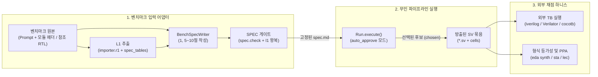
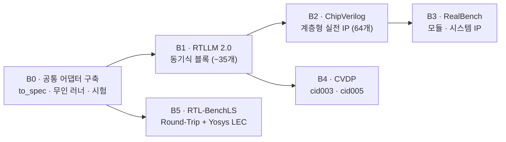

# BENCHMARK_PLAN

Oct 19, 2026 · @Seungjoon Lee

관련 문서: [ARCHITECTURE](./ARCHITECTURE.md) · [IMPLEMENTATION](./IMPLEMENTATION.md) · [LLM 기반 RTL 생성 파이프라인 설계](./docs/LLM%20%EA%B8%B0%EB%B0%98%20RTL%20%EC%83%9D%EC%84%B1%20%ED%8C%8C%EC%9D%B4%ED%94%84%EB%9D%BC%EC%9D%B8%20%EC%84%A4%EA%B3%84.md)

외부 RTL 생성 벤치마크 5종(**RTLLM 2.0**, **ChipVerilog**, **RealBench**, **CVDP**, **RTL-BenchLS**)을 현재 파이프라인에 적용해 평가하는 계획과 단계별 완료 기준입니다.

계획은 세 가지 원칙을 따릅니다.

- **파이프라인 코어의 원칙을 깨지 않습니다.** 외부 벤치마크를 위해 "IR이 유일한 소스"라는 원칙이나 생성·검증 격리 규칙을 우회하지 않습니다. 따라서 기존 RTL 코드의 빈칸 채우기(Masked-Content)나 줄 단위 패치(Bug Fixing) 트랙은 제외하고, **자연어 SPEC과 포트 정의로부터 모듈 트리 전체를 생성·방출하는 트랙**만 평가 대상으로 삼습니다.
- **이미 구축된 결정론적 도구를 최대한 재사용합니다.** P11에서 구현한 구조 추출기(`pipeline/importer/r1.py`), SPEC 2~4절 표 생성기(`pipeline/importer/spec_tables.py`), SPEC 검사 게이트(`pipeline/spec/check.py`), 오픈소스 EDA 래퍼(`department/bin/eda`)를 그대로 활용합니다.
- **공통 어댑터 하나에 벤치마크별 로더만 얹습니다.** 벤치마크마다 파이프라인을 따로 만들지 않고, ① 입력 변환(Prompt + 헤더 → 10개 섹션 `spec.md`), ② 무인 스케줄러 실행(`Run`), ③ 외부 채점기 호출(원본 TB 또는 Yosys LEC)의 3단계 공통 러너 위에서 5개 벤치마크를 모두 돌립니다.

---

## 1. 대상 벤치마크 5종과 적용 범위

| 단계 | 벤치마크 | 적용 트랙 / 범위 | 예상 문제 수 | 채점 기준 | 선정 목적 |
| --- | --- | --- | --- | --- | --- |
| **B1** | **RTLLM 2.0** | 동기식(Sequential) 설계 문제<br>(FIFO, FSM, 직병렬 변환, 산술·제어 블록) | ~35개<br>(전체 50개 중 클럭 있는 블록) | 원본 `testbench.v` (`iverilog`) + `eda synth`/`sta` (PPA) | 어댑터(SPEC 변환 + 무인 실행) 검증 및 기본 통과율·PPA 측정 |
| **B2** | **ChipVerilog** | 전체 64개 타겟<br>(Standalone / Multi-module / Cross-module, 5대 IP: OR1200, FPU, MIPS-16, I2C, CORDIC) | 64개<br>(중앙값 268줄, 최대 1,000줄+) | 원본 시뮬레이션 TB + 부분 등가성 검사 | 중대형·계층형 IP에서 **Architect 모듈 분해 + 하위 셀(`cells`) 재사용** 성능 입증 |
| **B3** | **RealBench** | 모듈 레벨 & 시스템 레벨 IP 생성<br>(UART, SPI, AES 등 오픈소스 IP) | 수십 개 모듈 및 시스템 Top | 원본 Verilator / Yosys 시뮬레이션 및 형식 검증 | 구조화된 명세 문서 기반의 실전 멀티모듈 통합 검증 능력 평가 |
| **B4** | **CVDP** | `cid003` (NL Spec-to-RTL)<br>`cid005` (Spec-to-RTL with Module Reuse) | 수백 개<br>(동기식 설계 필터링) | CVDP 공식 Docker 하니스 (`cocotb` / `iverilog` / `Verilator`) | 산업계 최신 에이전트 벤치마크 기준의 표준 지표(`pass@1`) 확보 |
| **B5** | **RTL-BenchLS** | `Round-Trip Reasoning`<br>(원본 RTL → SPEC 추출 → RTL 재생성) | 샘플링 세트 (100~300개 동기식 모듈) | `department/bin/eda lec`<br>(Yosys `equiv` + `miter` BMC) | 수작업 TB 없이 `pipeline.scheduler.port`(P11)와 연계한 대규모 재현성 평가 |

### 제외 범위 (명시적 제외)

- **코드 일부분 편집·빈칸 채우기:** CVDP의 `cid002`(Code Completion), `cid004`(Code Modification), `cid016`(Bug Fixing)과 RTL-BenchLS의 `Masked-Content`, `Repository-Issue` 트랙
- **검증 산출물 제출 과제:** CVDP의 `cid012`~`cid014`(외부 제출용 Verilog TB, 체커, SVA 작성) 및 단순 Q&A 트랙
- **클럭 없는 순수 조합회로(Combinational-only) 1차 제외:** 현재 `pipeline/spec/l1.py`와 `schema/ir.schema.json`은 최소 1개의 클럭 도메인을 전제로 합니다. 1차 평가에서는 클럭이 있는 동기식(Sequential) 설계만 대상으로 하며, 조합회로 지원(가상 샘플링 클럭 래퍼 후 방출 시 제거)은 선택 확장(B1a)으로 분리합니다.

---

## 2. 아키텍처 및 데이터 흐름



### 기존 모듈 재사용 매핑

| 필요한 기능 | 재사용하는 기존 모듈 | 추가·확장할 내용 |
| --- | --- | --- |
| 모듈 헤더에서 포트·파라미터·클럭/리셋 추출 | `pipeline/importer/r1.py`, `extract.py` | 벤치마크 프롬프트 안의 빈 모듈 선언(`module top(...); endmodule`)에서 L1 추출 및 클럭/리셋 극성 자동 확정(R2 무인 응답) |
| L1 → SPEC 2~4절 표 생성 및 왕복 검증 | `pipeline/importer/spec_tables.py` | 그대로 사용 (`section2`, `section3`, `section4`, `roundtrip_diff`) |
| 자연어 프롬프트 → 10개 섹션 `spec.md` 변환 | `pipeline/agents/spec_writer.py`, `pipeline/spec/check.py` | 원본 RTL 없이 **벤치마크 자연어 프롬프트 + `tables.md`**만 보고 10개 섹션 SPEC을 작성하는 `bench_spec_writer` 프롬프트 변형 추가 (B5 RTL-BenchLS는 기존 `spec_writer` 그대로 사용) |
| 파이프라인 실행 및 후보 선택 | `pipeline/scheduler/run.py` (`Run`), `experiments/p8a/pilot.py` | `awaiting_approval` 발생 시 자동 결정을 내리고 이어서 도는 무인 루프(`auto_approve`) 추가 |
| 하위 모듈(IP/셀) 재사용 (`cid005`, ChipVerilog) | `Run(..., cells=...)` 및 L1 `external` 모듈 | 벤치마크가 제공하는 하위 `.v`/`.sv` 파일들을 `cells`로 전달하고 L1 참조 연결 |
| 합성·면적·타이밍(PPA) 및 LEC 채점 | `department/bin/eda` (`lint`, `synth`, `sta`, `lec`, `comb`) | 그대로 호출하여 벤치마크 결과 JSON에 셀 수, 최악 경로 지연, LEC 통과 여부 기록 |

---

## 3. 저장소 구조 (추가)

```
chip-design-depart/
├── BENCHMARK_PLAN.md
├── experiments/
│   ├── p0/
│   ├── p8a/
│   └── bench/                      # 벤치마크 평가 프레임워크
│       ├── README.md               # 데이터셋 내려받기 경로, 실행 명령, 결과 요약
│       ├── common/
│       │   ├── schema.py           # 표준 문제 형식 (BenchItem: id, top, prompt, header_sv, cells, tb_info)
│       │   ├── to_spec.py          # 헤더 L1 추출(r1 + spec_tables) + BenchSpecWriter 호출 + spec.check 게이트
│       │   ├── runner.py           # 무인 Run 실행기 (auto_approve 정책, quota 재개, 결과 집계)
│       │   └── metrics.py          # pass@1, 후보별(SV/Python) 통과율, 에이전트 호출 수, PPA(eda synth/sta) 집계
│       ├── adapters/
│       │   ├── rtllm.py            # B1: RTLLM 2.0 로더 및 iverilog 채점 래퍼
│       │   ├── chipverilog.py      # B2: ChipVerilog 로더 (include/define 처리, Standalone/Multi/Cross 분류)
│       │   ├── realbench.py        # B3: RealBench 로더 및 Verilator/Yosys 채점 래퍼
│       │   ├── cvdp.py             # B4: CVDP JSONL 로더 (cid003, cid005 필터) 및 Docker 하니스 호출기
│       │   └── rtl_benchls.py      # B5: RTL-BenchLS Round-Trip 로더 (port.py R1~R5 + Run + eda lec)
│       └── run_bench.py            # 통합 CLI 진입점
└── tests/
    └── test_bench_adapter.py       # 가짜 에이전트로 어댑터·무인 승인·채점 흐름 단위 시험
```

---

## 4. 공통 모듈 상세 설계 (`experiments/bench/common/`)

### 4.1 표준 문제 레코드 (`BenchItem`)

모든 벤치마크 어댑터는 각 데이터셋의 문제를 아래 공통 구조로 정규화합니다.

```json
{
  "benchmark": "rtllm | chipverilog | realbench | cvdp | rtl_benchls",
  "id": "asyn_fifo",
  "category": "sequential | standalone | multi_module | cross_module | cid003 | cid005 | round_trip",
  "top": "asyn_fifo",
  "prompt_text": "원본 자연어 명세 전문",
  "header_sv": "포트·파라미터만 선언된 빈 모듈 또는 헤더 파일 경로",
  "incdirs": [],
  "defines": {},
  "cells": ["재사용할 하위 모듈 .v/.sv 경로 목록"],
  "reference_rtl": ["정답 RTL 경로 (RTL-BenchLS 또는 R2 클럭/리셋 힌트용, 생성 에이전트에는 격리)"],
  "eval": {
    "kind": "iverilog | verilator | cvdp_docker | yosys_lec",
    "tb_files": ["testbench.v"],
    "pass_pattern": "Your Design Passed|PASS"
  }
}
```

> [!IMPORTANT]
> **정답 RTL 격리 원칙:** 벤치마크 데이터셋에 정답 RTL(`reference_rtl`)이 포함되어 있더라도, B1~B4에서는 `BenchSpecWriter` 및 파이프라인의 모든 에이전트(Architect, Author, Verifier, Repair, Arbiter) 작업 디렉터리에 정답 RTL을 절대 노출하지 않습니다. 정답 RTL은 오직 B5(RTL-BenchLS Round-Trip의 초기 SPEC 추출 및 최종 LEC 채점)에서만 사용합니다.

### 4.2 입력 변환기 (`to_spec.py`: Prompt + Header → `spec.md`)

1. **L1 및 2~4절 표 결정론적 생성:**
   - 문제에서 주어진 모듈 선언(`header_sv`)을 `pipeline.importer.r1`의 추출기(`Extractor`)에 넣어 포트(`ports`), 파라미터(`params`), 클럭/리셋 후보를 뽑습니다.
   - 프롬프트 본문에서 클럭 에지(`posedge`/`negedge`)와 리셋 극성(`active-low`/`active-high`), 동기/비동기 리셋 여부를 파싱해 R2 항목을 자동으로 채우고 `pipeline.importer.spec_tables`로 2~4절 마크다운 표(`tables.md`)를 만듭니다.
   - 만약 ChipVerilog처럼 외부 `` `include `` 헤더의 매크로 상수를 포트 폭에 쓰는 경우, `r1.py`의 `-I` / `-D` 기능으로 상수를 풀어서 L1에 반영합니다.
2. **10개 섹션 SPEC 작성 (`BenchSpecWriter`):**
   - coding agent가 `template.md`, 고정된 `tables.md`, 벤치마크의 `prompt_text`(및 `cid005`/Cross-module인 경우 하위 모듈의 포트 정의)를 받아 `out/spec.md`를 작성합니다.
   - 종료 게이트: `tools/pl.py spec_gate out/spec.md --tables tables.md --top <top>` 통과 (`pipeline.spec.check` 오류 0개 + `roundtrip_diff` 일치).

### 4.3 무인 실행 정책 (`runner.py`: `--auto-approve`)

대량 벤치마크 실행에서는 사람 승인 대기(`waiting_approval`)로 멈추지 않도록 `runner.py`가 `Run.execute()`를 감싸며 다음 규칙으로 자동 결정(auto-resolve)을 기록합니다(결정자는 `"bench_auto"`로 기록해 감사 추적성 유지).

| 대기 종류 (`pending.kind`) | 조건 | 무인 자동 결정 | 근거 및 안전장치 |
| --- | --- | --- | --- |
| `expectation`<br>(기댓값 수정 승인 대기) | Arbiter가 `test_wrong`으로 판정하고 `patch`를 제안함 | **자동 승인 (`approve`)** | 승인마다 Repair 횟수 되돌리기는 후보당 최대 `max_auto_approves`(기본 3회)까지만 허용해 무한 루프 방지 |
| `repair_conflict`<br>(하위 모듈 간 Repair 충돌) | 첫 번째 충돌 발생 | **Architect 재구성 (`architect`)** | P8a 실험(`axis_async_fifo`)에서 모듈 간 계약 불일치는 Architect 재구성이 근본 해결책이었음 |
| `repair_conflict`<br>(하위 모듈 간 Repair 충돌) | Architect 재구성 뒤에도 다시 충돌 | 남은 Repair 횟수(`remaining > 0`)가 가장 많은 모듈로 **고칠 모듈 지정 (`repair`)** | 재구성 상한(기본 1회) 도달 후에는 남은 Repair 예산 안에서 수렴 시도 |

### 4.4 방출 RTL 패키징 및 외부 채점 (`eval_harness`)

1. 파이프라인이 `pass`로 끝나면 선택된 후보(`chosen`, 예: `c0` 또는 `c1`)의 모든 모듈 IR을 SV로 방출합니다.
2. 파이프라인이 `failed`로 끝났더라도 후보 중 마지막 IR이 모두 존재하는 묶음이 있으면, [pilot.py](file:///Users/sjlee/Workspace/Project/chip-design-depart/experiments/p8a/pilot.py#L58-L75)와 마찬가지로 **후보별(`c0` SV, `c1` Python) 방출 RTL을 외부 채점기에 넣어 각각 통과 여부를 기록**합니다 (`pass_pipeline_and_bench` vs `pass_bench_only` 구분).
3. 방출된 SV 파일들과 `cells`를 모아 각 벤치마크의 채점기(`iverilog`, `verilator`, CVDP Docker, `eda lec`)를 돌리고, 통과한 설계에 대해서는 `department/bin/eda synth` 및 `eda sta`를 실행해 합성 셀 수와 최악 경로 지연을 함께 수집합니다.

---

## 5. 단계별 실행 계획과 완료 기준



---

### B0. 공통 벤치마크 어댑터 및 무인 러너 구축

벤치마크 데이터셋을 넣기 전에 공통 변환기(`to_spec.py`), 무인 승인 루프(`runner.py`), 집계기(`metrics.py`)를 만들고 가짜 에이전트(fake agent)와 기존 골든 블록 1개로 검증합니다.

#### 작업
1. `experiments/bench/common/schema.py`: `BenchItem`, `BenchResult` 데이터 구조 정의
2. `experiments/bench/common/to_spec.py`: 모듈 헤더 SV + 프롬프트 텍스트 → `r1` 추출 → `spec_tables` 2~4절 생성 → `BenchSpecWriter` 에이전트 호출 → `spec_gate` 검증
3. `experiments/bench/common/runner.py`:
   - `Run` 실행 및 `waiting_approval` 시 4.3절 규칙에 따른 자동 결정(`approve.py` API 호출)
   - `paused_quota` 발생 시 상태 보존 및 재개(`--resume`) 지원
   - 후보별(`c0` SV, `c1` Python) 방출 RTL 추출 및 `eda synth`/`sta`/`comb` 실행
4. `experiments/bench/run_bench.py`: `--bench`, `--filter`, `--limit`, `--roles`, `--auto-approve`, `--resume` 옵션을 가진 통합 CLI 작성
5. `tests/test_bench_adapter.py`: 가짜 에이전트로 헤더 추출 → SPEC 생성 → 무인 승인(기댓값 승인 1회, 충돌 재구성 1회) → 외부 TB 채점까지 이어지는 단위 시험 작성

#### 완료 기준
- [ ] `pytest tests/test_bench_adapter.py` 통과 (LLM 호출 없이 가짜 에이전트로 전체 흐름 검증)
- [ ] 기존 `axis_adapter`의 원본 헤더와 설명만 넣었을 때 `to_spec.py`가 유효한 10개 섹션 `spec.md`를 만들고 `spec.check`를 통과함

---

### B1. RTLLM 2.0 적용 (Sequential 서브셋)

외부 의존성이 가장 적고 `iverilog`만으로 즉시 채점할 수 있는 **RTLLM 2.0**의 동기식 설계 문제들을 첫 타겟으로 돌려 어댑터의 안정성과 기본 통과율·PPA를 확인합니다.

#### 작업
1. `experiments/bench/adapters/rtllm.py` 구현:
   - RTLLM 2.0 디렉터리에서 문제별 `design_description.txt`, 모듈 헤더, `testbench.v`를 읽어 `BenchItem`으로 변환
   - 클럭 포트가 있는 동기식(Sequential) 설계와 순수 조합회로(Combinational) 설계를 자동 분류 (`--subset sequential` 기본)
   - `iverilog -g2012`로 방출된 `*.sv`와 원본 `testbench.v`를 컴파일·실행해 `"Pass"` / `"Passed"` 문자열 및 종료 코드로 채점
2. 파일럿 5개 블록(`asyn_fifo`, `pulse_detect`, `serial2parallel`, `fsm`, `traffic_light`) 먼저 실행해 `BenchSpecWriter` 프롬프트 다듬기
3. RTLLM 2.0 동기식 전체(~35개) 실행 및 리포트(`build/bench/rtllm/summary.json`) 생성
4. *(선택 확장 B1a)* 순수 조합회로 문제(~15개)를 위해 가상 클럭(`__bench_clk`)으로 파이프라인을 돌린 뒤 최종 방출된 Top SV 래퍼에서 클럭 포트를 제거하는 조합 전용 모드 시험

#### 완료 기준
- [ ] 파일럿 5개 블록에서 SPEC 변환 게이트 5/5 통과 및 외부 `testbench.v` 채점 정상 동작 확인
- [ ] RTLLM 2.0 동기식 문제 전체에 대해 구문 통과율(Syntax), 기능 통과율(`pass@1`, SV 후보 vs Python 후보), 합성 성공률 및 PPA(`eda synth`/`sta`) 표가 `build/bench/rtllm/summary.json`에 기록됨

---

### B2. ChipVerilog 적용 (계층형·중대형 IP 64개 타겟)

본 파이프라인의 핵심 강점인 **Architect 계층 분해**와 **하위 모듈 재사용**을 **ChipVerilog**(OR1200, FPU, MIPS-16, I2C, CORDIC의 64개 타겟)에서 검증합니다.

#### 작업
1. `experiments/bench/adapters/chipverilog.py` 구현:
   - 64개 타겟을 복잡도 등급(`standalone`, `multi_module`, `cross_module`)과 5대 IP 패밀리별로 로드
   - OpenCores 특유의 `` `include "timescale.v" `` 및 `` `define `` 상수 헤더를 `r1.py`의 `-I`, `-D`에 연결해 L1 파라미터와 `notes.json`(섹션 9 구현 제약의 상수 표)으로 전달
   - `cross_module` 타겟이 호출하는 하위 모듈 파일들을 `BenchItem.cells`에 등록하고, `BenchSpecWriter`가 하위 모듈의 인터페이스 요약을 SPEC에 반영하도록 안내
2. I2C 패밀리의 `inout` 포트(`sda`, `scl`) 등 트라이스테이트 패드가 있는 타겟은 `pipeline/tb/gen.py`의 `pad_top` 래퍼와 원본 TB 연결 확인
3. 패밀리별 대표 타겟 실행 후 전체 64개 타겟으로 확장 실행

#### 완료 기준
- [ ] `standalone`, `multi_module`, `cross_module` 세 등급 모두에서 최소 1개 이상의 타겟이 SPEC 변환 → 파이프라인 생성 → 원본 검증을 끝까지 통과함
- [ ] 복잡도 등급별(단일 모듈 대 다중 모듈) Architect의 하위 모듈 분해 수, Repair 수렴 횟수, 최종 통과율 비교 결과가 `build/bench/chipverilog/summary.json`에 기록됨

---

### B3. RealBench 적용 (실전 오픈소스 IP 모듈 및 시스템 레벨)

명세 문서의 구조가 실제 사내 SPEC과 가장 비슷한 **RealBench**를 연결해 모듈 레벨과 시스템(Top) 레벨 생성을 평가합니다.

#### 작업
1. `experiments/bench/adapters/realbench.py` 구현:
   - RealBench의 IP별 명세서(문서, 포트·레지스터 표)와 Verilator/Yosys 채점 하니스를 `BenchItem`으로 연결
   - 레지스터 맵 표가 있는 IP는 CSV로 추출해 `pipeline/spec/regmap.py`(`--regmap`)와 연동
2. 모듈 레벨 과제와 시스템(멀티모듈) 레벨 과제를 나눠 실행하고, 원본 Verilator 테스트벤치 및 형식 검증 스크립트로 채점

#### 완료 기준
- [ ] RealBench 어댑터가 명세와 레지스터 표를 10개 섹션 `spec.md`로 변환해 `spec.check`를 통과함
- [ ] 모듈 레벨 및 시스템 레벨 대표 IP에서 파이프라인 생성 RTL이 RealBench 채점 하니스를 통과하고 결과가 `build/bench/realbench/summary.json`에 기록됨

---

### B4. CVDP 적용 (`cid003` Spec-to-RTL & `cid005` Module Reuse)

NVIDIA의 **CVDP** 데이터셋에서 본 프로젝트의 목적에 맞는 RTL 생성 카테고리(`cid003`, `cid005`)를 추출해 공식 Docker 컨테이너 하니스로 평가합니다.

#### 작업
1. `experiments/bench/adapters/cvdp.py` 구현:
   - CVDP JSONL(`nonagentic_code_generation_no_commercial.jsonl`, `agentic_code_generation_no_commercial.jsonl`)에서 `cid003`과 `cid005` 문제만 필터링
   - 문제 컨텍스트(`/code/docs`, `/code/rtl`)에서 생성 대상 Top 모듈 헤더와 재사용할 기존 모듈(`cells`)을 분리
   - 파이프라인이 방출한 `*.sv` 파일들을 CVDP 평가 워크스페이스의 `/code/rtl/` 구조에 맞게 배치한 뒤, CVDP의 Docker 기반 `cocotb` / `iverilog` 채점 스크립트를 호출해 통과 여부 수집
2. `cid003` 파일럿 10개와 `cid005` 파일럿 5개를 먼저 돌려 컨테이너 연동 확인 후 전체 세트로 확장

#### 완료 기준
- [ ] `cid003`(단독 생성)과 `cid005`(기존 모듈 재사용) 파일럿 세트가 SPEC 변환부터 CVDP Docker 채점까지 무인으로 완주함
- [ ] 카테고리별(`cid003`, `cid005`) 통과율과 실패 원인 분류(SPEC 변환 실패, 내부 검증 실패, 내부 검증은 통과했으나 외부 CVDP TB 실패)가 `build/bench/cvdp/summary.json`에 기록됨

---

### B5. RTL-BenchLS 적용 (`Round-Trip Reasoning` + Yosys LEC)

수작업 테스트벤치 없이 형식 등가성(LEC)으로 평가하는 **RTL-BenchLS**의 `Round-Trip` 트랙은 이미 구현된 **P11(`pipeline/scheduler/port.py`)** 및 **`department/bin/eda lec`**과 직결됩니다.

#### 작업
1. `experiments/bench/adapters/rtl_benchls.py` 구현:
   - RTL-BenchLS의 검증된 원본 Verilog 디자인(`gold.v`)을 입력으로 받아 `pipeline.importer.r1`으로 L1 추출 및 `r2` 자동 응답 수행
   - 전체 Porter(R3~R4)를 다 돌리지 않고도 원본 RTL과 `tables.md`, `refsim` 도구를 `SpecWriter`(`pipeline/agents/spec_writer.py`)에 주어 10개 섹션 `spec.md`를 생성(R5 경량 경로)
   - 생성된 `spec.md`만으로(원본 RTL 없이) `Run`을 무인 실행해 재생성 RTL(`gate`) 방출
   - `department/bin/eda lec`(Yosys `equiv_make` + `miter` 순차 BMC)로 원본 RTL(`gold`)과 재생성 RTL(`gate`)의 형식 등가성을 판정
2. 필요 시 P11 R6의 루프(불일치 시 반례 자극을 뽑아 Arbiter가 `spec_gap`인지 `regen_defect`인지 판정)를 켜서 1회 왕복(`pass@round1`)과 SPEC 보정 후 왕복(`pass@r6`)을 함께 측정

#### 완료 기준
- [ ] 외부 테스트벤치 파일 없이 원본 RTL 하나만으로 `SPEC 추출 → 무인 재생성 → Yosys LEC 등가 증명` 전 과정이 자동으로 실행됨
- [ ] 샘플링 세트에서 1회 왕복 등가 증명률과 P11 R6(SPEC 보정) 적용 후 등가 증명률이 `build/bench/rtl_benchls/summary.json`에 기록됨

---

## 6. 수집 지표 및 리포트 양식

모든 벤치마크 실행 결과는 `build/bench/<벤치마크>/summary.json`과 마크다운 리포트(`summary.md`)로 남기며, 다음 지표를 공통으로 기록합니다.

1. **단계별 통과율:**
   - `spec_gate_pass`: 벤치마크 문제 → 10개 섹션 `spec.md` 변환 성공률
   - `pipeline_pass`: 파이프라인 내부 검증(E1 lint + E2 Verifier 참조 모델) 수렴 비율
   - `bench_pass_chosen`: 파이프라인이 최종 선택한 후보(`chosen`)가 벤치마크 원본 채점(TB 또는 LEC)을 통과한 비율 (**공식 `pass@1`**)
   - `bench_pass_any`: 후보 묶음(`c0` SV, `c1` Python) 중 하나라도 벤치마크 원본 채점을 통과한 비율
2. **언어 및 에이전트 비용 비교 (P8a 연장):**
   - SV 조각 후보(`c0`) 대 Python 조각 후보(`c1`)의 외부 벤치마크 통과율, 평균 Repair 횟수, 번역기 검사(`pyequiv`) 통과율
   - 문제당 평균 에이전트 호출 횟수(`agent_runs`), 소요 시간(분), 무인 자동 승인(`expectation` 승인, `architect` 재구성) 발동 횟수
3. **오류 원천 분류 (내부 통과 후 외부 TB 실패 시):**
   - `spec_omission`: 원본 벤치마크 프롬프트에 적히지 않은 암묵적 동작을 외부 TB가 요구한 경우
   - `converter_gap`: 프롬프트에는 있었으나 `BenchSpecWriter`가 `spec.md`로 옮기면서 빠뜨린 경우
   - `verifier_miss`: `spec.md`에는 있었으나 파이프라인의 두 Verifier가 모두 놓친 코너 케이스
4. **합성 및 물리 지표 (PPA):**
   - `eda synth` 통과율, 게이트 셀 수(`cells`), `eda sta` 최악 경로 지연(ns), `eda comb` 조합 루프 0건 확인
