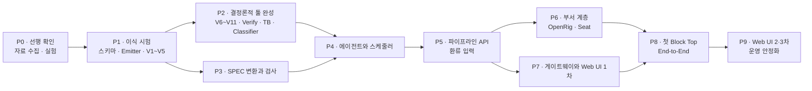

# IMPLEMENTATION

Oct 8, 2026 · @Seungjoon Lee

[ARCHITECTURE.md](./ARCHITECTURE.md)를 구현하는 순서와 단계별 완료 기준입니다.

계획은 두 가지 원칙을 따릅니다.

- **LLM 없이 먼저 검증합니다.** IR 스키마, Emitter, Validator, Verify를 LLM 없이 먼저 만들고, 기존 블록으로 검증합니다. 결정론적 툴이 틀리면 그 위에 올린 에이전트의 결과도 판정할 수 없기 때문입니다.
- **안쪽에서 바깥쪽으로 쌓습니다.** 실행 계층을 먼저 만들고, 그다음 부서 계층과 Web UI를 붙입니다. 각 단계는 앞 단계의 산출물만으로 시험할 수 있어야 합니다.

일정은 인원과 자료 입수 시점에 달려 있어서 적지 않았습니다. 순서와 완료 기준만 정합니다.

---

## 0. 전제와 가정

| 항목 | 가정 | 근거 |
| --- | --- | --- |
| 파이프라인 구현 언어 | Python | pyslang, cocotb, 게이트웨이가 모두 Python입니다. **설계 문서에서 확정된 사항은 아닙니다.** |
| IR 스키마 | JSON Schema (draft 2020-12) | V1 단계의 수단 |
| SV 파싱 | pyslang | V3, V4 단계의 수단 |
| 시뮬레이션 | Verilator + cocotb | E1, E2 단계의 수단 |
| 최종 lint | VC SpyGlass 사내 템플릿을 래퍼로 호출 | E3 단계의 수단 |
| 프런트엔드 | React + TypeScript | 확정 사항 |
| 저장소 | Git. Seat별 worktree | 확정 사항 |
| LLM 실행 | coding agent(Claude Code(기본), Pi, Codex, Antigravity(agy) 등). Seat는 OpenRig 장기 세션, 파이프라인 에이전트는 스케줄러가 띄우는 headless 세션. 모델 API를 직접 호출하는 코드는 없음 | 확정 사항 |
| 사람과 Seat의 대화 | Web UI → 게이트웨이 → OpenRig 데몬 → Seat | 확정 사항 |

## 1. 저장소 구조 (제안)

```
chip-design-depart/
├── ARCHITECTURE.md
├── IMPLEMENTATION.md
├── docs/                       # 상세 설계 문서 (Chip Design Department, RTL 생성 파이프라인)
├── examples/i3c_basic_controller/ # 공개 예시 SPEC (I3C Basic v1.2 controller, 10개 섹션)
├── experiments/p0/             # P0 실험 키트 (X1~X6 안내서, 실행 스크립트)
├── schema/                     # IR JSON Schema (L0~L3), patch 스키마, 환류 양식 스키마
├── pipeline/
│   ├── ir/                     # IR 로더, 심볼 테이블, reads/writes 그래프, Python 조각 번역기, 설계 모델 실행기
│   ├── validator/              # V1~V11
│   ├── emitter/                # SV 템플릿, 소스맵, SDC 골격
│   ├── verify/                 # E1~E3 래퍼, 리포트 파서, 번역기 검사(설계 모델 대 RTL)
│   ├── tb/                     # cocotb 하니스 생성기, 프로토콜 체커 라이브러리
│   ├── classifier/             # 실패 분류 11종, 외부 리포트 입력
│   ├── patch/                  # patch 적용 툴, 쓰기 범위 강제
│   ├── spec/                   # Word/PDF/엑셀/다이어그램 변환, SPEC 검사
│   ├── agents/                 # coding agent 실행기(런타임별 실행 명령), 역할별 TASK 템플릿과 도구 집합
│   ├── scheduler/              # 의존 그래프, 게이트, 대기열, 상태 저장
│   └── api/                    # 실행 제출, 상태 조회, 환류 (CLI + HTTP)
├── tools/                      # MCP 도구 서버 (Validator 사전 실행, 트레이스 조회 등)
├── eda/                        # EDA 표준 래퍼 스크립트
├── rig/                        # rig.yaml, Seat 기본 지침
├── gateway/                    # Python 게이트웨이
├── web/                        # React + TypeScript
└── tests/
    ├── fixtures/               # 설계 문서의 IR 예시 (pkt_parser, pkt_rx_top)
    ├── golden/                 # 이식 시험 블록의 IR, 기대 RTL
    └── ...
```

## 2. 단계 개요



P2와 P3은 병렬로 진행할 수 있고, P6과 P7도 병렬로 진행할 수 있습니다. P8a(Python 동작 조각)는 P8 뒤에 사용자 결정으로 더한 단계이고, P10(다중 클럭과 리셋)과 P11(원본 RTL에서 IR과 SPEC 만들기)도 그 뒤에 더한 단계입니다.

---

## P0. 선행 확인

설계의 전제가 실제 환경에서 성립하는지 확인합니다. 결과에 따라 이후 단계의 선택지가 바뀝니다.

실행 절차, 통과 기준, 스크립트는 [experiments/p0/README.md](./experiments/p0/README.md)에 있습니다.

### 실험

| # | 실험 | 실패할 때의 대안 | 영향을 받는 단계 |
| --- | --- | --- | --- |
| X1 | coding agent(로컬 모델)가 스키마에 맞는 IR 파일을 쓰고 검사 도구를 쓰는 비율 (런타임과 모델 조합별) | 다른 조합으로 교체하거나 출력 단위를 작게 쪼갬 | P4 |
| X2 | 비전 모델을 쓰는 coding agent의 타이밍 다이어그램 → WaveJSON 정확도 | 사람이 WaveJSON을 작성하고 coding agent는 초안만 만듦 | P3 |
| X3 | coding agent 런타임이 로컬 모델로 동작하는지. OpenRig Seat(Pi 런타임의 Seat별 `models.json`)와 headless 실행 둘 다 | `terminal` 런타임에 다른 coding agent를 올림 | P4, P6 |
| X4 | rig.yaml edge 종류. **완료:** `handoff`, `can_message`는 없음. 있는 다섯 가지로 대응 관계를 정함 | 해당 없음 (격리는 원래 권한으로 강제함) | P6 |
| X5 | 폐쇄망 설치. npm 사내 미러, 데몬의 외부 호출(플러그인 자동 갱신 1건 확인. 실패해도 동작), coding agent 런타임의 외부 호출 | 설정이나 패치로 호출을 끔 | P6 |
| X6 | 게이트웨이 → OpenRig 데몬 API → Seat 대화 왕복. 보낸 사람 구분, 동시 전송, 응답을 메시지 단위로 읽기 | Seat가 정해진 형식의 응답 파일이나 큐 항목을 남기는 규약 | P7, P9 |

### 수집할 자료

- Word/PDF SPEC 양식과 예시, 엑셀 레지스터 맵, 블록 다이어그램 원본(Visio/SVG)
- VC SpyGlass 사내 템플릿의 호출 방식과 리포트 형식
- 표준 동기화 셀, 메모리 매크로 래퍼 규약, 표준 프로토콜 태그 목록, 사내 코딩 가이드
- 로컬 모델 목록(언어, 비전)과 계열
- 이식 시험 대상 블록 3개와 그 테스트벤치: FSM 중심, datapath 중심, 다중 클럭. 이 중 하나는 계층 모듈이어야 합니다.

### 완료 기준

2026-10-11 기준, 사내 자료를 공개 자료와 임시 표준으로 대체해 충족했습니다. 상세는 [experiments/p0/README.md](./experiments/p0/README.md)에 있습니다.

- [x] X1\~X6의 결과가 기록되어 있고, 실패한 항목은 대안이 정해져 있습니다. X1과 X2는 agy(클라우드 모델)로 통과했고, 로컬 모델 판정은 사용자가 따로 진행합니다
- [x] 이식 시험 블록 3개와 사내 템플릿을 받았습니다. 공개 블록 4개로 대체했고([tests/golden/](tests/golden/README.md)), SpyGlass 템플릿은 제외했습니다

---

## P1. 블록 이식 시험

LLM 없이 스키마의 표현력과 Emitter의 정확성을 확인합니다. 설계 문서의 절차 2\~7을 이 단계에서 수행합니다. 절차 1(SPEC 변환)은 P3에서 수행합니다.

### 작업

1. **스키마.** `schema/`에 L0\~L3의 JSON Schema를 작성합니다. 모듈 role 4종과 블록 종류 5종을 포함합니다. v0 초안은 `schema/ir.schema.json`에 있습니다.
2. **IR 코어.** `pipeline/ir/`에 로더, 이름 기반 심볼 테이블, reads/writes 그래프를 만듭니다.
3. **Validator V1\~V5.** 스키마, 참조, 표현식(pyslang), 조각, 드라이버 단계입니다. 모든 오류에 노드 이름이나 `id`를 붙입니다.
4. **최소 Emitter.** 블록 종류 5종의 방출, `domain_map` 기반 클럭과 리셋 배선, `// @ir <id>` 주석, 소스맵을 만듭니다.
5. **손 이식.** 블록 3개를 손으로 IR에 옮기고 `tests/golden/`에 둡니다. 막힌 지점은 기록 항목 표에 따라 남깁니다.
6. **판정.** 방출된 RTL이 기존 테스트벤치와 VC SpyGlass 사내 템플릿을 통과하는지 봅니다.

### 진행 상황 (2026-10-11)

| 작업 | 상태 | 위치 |
| --- | --- | --- |
| 1. 스키마 | v0. 이식 시험에서 `cdc_sync`의 `gray`, 파라미터의 `local`을 추가 | `schema/ir.schema.json` |
| 2. IR 코어 | 완료: 로더, 번들 펼치기, domains에서 클럭·리셋 포트 유도, FSM 상태 레지스터, 읽기·쓰기 이름 공간 | `pipeline/ir/model.py` |
| 3. Validator V1\~V5 | 완료. V3, V4는 IR 하나를 탐침 모듈로 만들어 pyslang으로 한 번에 컴파일하고, 진단 줄을 IR 노드로 되돌림. 조각의 실제 읽기·쓰기와 대입 종류는 구문 트리에서 뽑음 | `pipeline/validator/` |
| 4. 최소 Emitter | `comb`, `seq`(리셋 분기 포함), `fsm`, `cdc_sync`(`2ff`, `gray`), `memory`(`inferred`), 인스턴스(`domain_map` 배선, 번들 연결), localparam, `// @ir` 주석, 소스맵. 동기화 셀은 임시 표준 `sync_2ff #(WIDTH)` | `pipeline/emitter/sv.py` |
| 5\~6. 손 이식과 판정 | **완료 (2026-10-11), 공개 블록으로 대체.** 4개 블록(계층, FSM, datapath, 다중 클럭)의 방출 RTL이 원본 테스트벤치 49개를 모두 통과. 골격 코드의 E1 위반 0건. SpyGlass 판정은 제외. 기록 항목과 판정은 [tests/golden/README.md](tests/golden/README.md) | `tests/golden/`, `tests/sim/test_golden.py` |

**검증.**
- 설계 문서의 예시 IR 2개가 V1\~V5를 통과합니다.
- 일부러 넣은 오류 18종을 모두 맞는 단계와 노드로 잡습니다.
- X1 리허설에서 모델이 만든 실제 IR 2개도 원인 위치를 짚어 거부합니다.
- 방출한 RTL은 pyslang elaboration에서 진단 0건입니다.
- 시뮬레이션: Verilator 5.052와 cocotb 2.1.0으로, 방출한 `pkt_parser`를 SPEC 기반 Python 참조 모델과 사이클 단위로 비교합니다. 정상 패킷, 잡음, 간격, 연속 패킷, 무작위 입력 3종이 통과합니다. 조각에 버그를 하나 넣은 변이는 3종 모두 실패합니다(`tests/sim/`). 시뮬레이션은 저장소의 `.venv`에서 돌립니다.

```bash
uv venv --python 3.11 .venv && uv pip install --python .venv/bin/python cocotb pyslang==10.0.0 jsonschema pytest
.venv/bin/python -m pytest tests            # 시뮬레이션 포함
```

```bash
python3 -m pipeline.emitter.sv tests/fixtures/*.ir.json -o build/rtl
```

### 완료 기준

공개 블록으로 대체해 판정했습니다 (2026-10-11). VC SpyGlass 항목은 제외했습니다.

- [x] 블록 3개의 방출 RTL이 기존 테스트벤치를 통과합니다. 4개 블록, 원본 테스트벤치 49개 모두 통과
- [x] ~~골격 코드에서 SpyGlass 위반이 0건입니다~~ (제외). 대신 E1 Verilator `-Wall`에서 골격 줄의 위반 0건
- [x] 기록 항목(표현 불가 구문, 우회 표현, 원시 블록 비중, Validator 오탐)을 정리하고, 판정 규칙에 따라 스키마 조정안을 확정했습니다. `gray` 동기화, 추론형 메모리, localparam을 추가했고 `generate`는 설정별 IR로 대응
- [x] 원시 블록 비중의 기준선(0.46)과 Repair 반복 상한의 초기값(모듈당 5)을 정했습니다

> **분기점.** 원시 블록 비중이 대부분이면 JSON 계층을 얇게 줄이는 방향으로 ARCHITECTURE.md를 개정한 뒤 P2로 넘어갑니다.

---

## P2. 결정론적 툴 완성

파이프라인에서 LLM이 아닌 부분을 모두 완성합니다.

| 영역 | 작업 | 완료 기준 |
| --- | --- | --- |
| Validator | V6 래치와 루프, V7 리셋, V8 도메인, V9 FSM, V10 계층, V11 동결 해시 | 규칙마다 통과 사례와 실패 사례의 단위 테스트가 있고, golden IR 3개는 오탐 없이 통과. **진행 (2026-10-10): V6\~V11 구현.** 단계별 실패 사례 10종과 V11 테스트가 있고, 예시 IR 2개는 오탐 없이 통과. **golden IR(공개 블록 4개, 7개 모듈)은 V1\~V10 오류·경고 0건, V11 변경 없음 (2026-10-11).** 조합 경로는 대입문 단위로 계산(`pipeline/validator/structure.py`) |
| Emitter | SDC 골격(클럭 정의, 비동기 클럭 그룹, CDC 경로), `external` 참조, 전력 도메인 L1 기록, `memory` 매크로 래퍼 | Emitter 대표 출력물의 SpyGlass 통과를 회귀 테스트로 CI에 등록. **진행 (2026-10-11):** SDC 골격(`pipeline/emitter/sdc.py`: 클럭 정의, `async_to`로 비동기 클럭 그룹, 계층 전체의 `cdc_sync`에 대한 CDC 경로 제약), `external`은 방출하지 않고 `rtl_files`를 `filelist.f`에 넣음. 전력 도메인은 스키마의 L1 필드와 동결 범위로 기록됨(UPF 형식이 정해지면 출력 추가). `memory`는 매크로 래퍼 규약을 받은 뒤 함. SpyGlass 회귀는 이번 구현에서 제외 |
| Verify | E1 Verilator lint, E2 Verilator sim, E3 SpyGlass 래퍼와 리포트 파서. 라이선스 대기열 | 세 단계 결과가 같은 형식(툴, 규칙, 파일, 줄, 메시지)으로 나옴. **진행 (2026-10-11): E1, E2 구현** (`pipeline/verify/run.py`). E2는 시드를 여러 개 주면 초기값을 무작위화해 실행하고(T1), 실패 목록이나 DUT 출력이 시드에 따라 달라지면 `T1_INIT`으로 냄. E1은 `-Wall` 경고도 실패로 보고, E2는 cocotb 결과 파일의 예외 타입을 규칙으로 냄(`AssertionError`는 기댓값 불일치). 빌드 실패와 결과 파일 누락도 같은 형식으로 냄. E3과 라이선스 대기열은 이번 구현에서 제외 |
| 테스트벤치 | L1에서 cocotb 하니스 생성. 번들 프로토콜별 드라이버, 모니터, 스코어보드 골격. 프로토콜 체커 라이브러리 | golden 블록에 생성된 하니스를 붙이고 손으로 쓴 참조 모델로 T1\~T5 실행. **진행 (2026-10-11):** 생성기(`pipeline/tb/gen.py`)는 L1만으로 하니스 설정을 만들고, 내부 신호 목록은 Verify만 쓰는 별도 파일로 둠(Verifier 격리). 라이브러리(`pipeline/tb/lib.py`): `valid_ready` 드라이버, 모니터, 프로토콜 체커(T2), 스코어보드(T3), 속성 등록(T4), 트레이스. FSM 전이 커버리지(T5 일부)는 `pipeline/tb/report.py`. 예시 블록 `pkt_parser`에 생성 하니스와 손으로 쓴 참조 모델(`tests/sim/tb_pkt_parser_h.py`)을 붙여 T1\~T4와 전이 커버리지 통과. **golden 블록 적용 (2026-10-11):** `axis_cobs_decode`, `axis_adapter`, `axis_async_fifo`에 생성 하니스와 손으로 쓴 참조 모델을 붙여 시드 3개로 T1\~T5 통과. T5에 Verilator line/toggle/branch 커버리지와 요구사항 ID 커버리지를 추가 (`tests/golden/run_golden.py --harness`). 남은 것: `valid_ready` 외 프로토콜(사내 태그 목록 대기) |
| Classifier | 실패 유형 11종. 소스맵으로 조각 내부와 골격 구분. 외부 리포트 입력 경로 | 유형마다 재현 사례가 있음. **진행 (2026-10-11): 툴 결과로 판별하는 7종 구현** (`pipeline/classifier/classify.py`): 스키마 위반, IR 의미 오류, lint 조각 내부, lint 골격, sim 불일치, TB 실행 오류, 인터페이스 변경 필요(V11, L1을 고치려던 patch, 동결된 L1 값에 걸린 lint). Emitter 소스맵에 IR 값이 그대로 놓인 줄(조각 본문, 전이 조건, 신호 타입, 리셋값, 포트 선언, 연결로 정해진 인스턴스 핀)을 `fragment` 항목으로 추가해 조각과 골격을 가르고, 그 노드를 role이 고칠 수 없으면 인터페이스 변경으로 보냄. 외부 리포트는 같은 결과 형식으로 넣음. 나머지 4종(기댓값 오류 의심, 자식 모듈 원인 의심, Verifier 간 불일치, 후보 간 불일치)은 루프 이력이나 에이전트 판정이 필요해 P4 스케줄러에서 붙임 |
| patch 툴 | `{op, target, field, value}` 적용. 쓰기 범위와 동결 범위를 강제하고 waiver 추가를 거부 | 범위를 벗어난 patch가 거부되는 테스트. **완료 (2026-10-11)** (`pipeline/patch/apply.py`). `set`, `add`, `remove`. 하나라도 거부되면 아무것도 적용하지 않음. 범위 규칙과 별개로 동결 범위 해시도 비교함. 진동 감지용 IR 해시 제공. 전처리 지시어(`` `ifdef ``, `` `line ``, `` `define ``)도 거부. CLI는 `-o` 없이 실행하면 Validator 검사만 함(Repair의 patch 사전 실행). `top`과 `block_top`은 신호와 타입까지 동결 범위에 넣어 patch할 수 없음 |
| 불일치 리포트 | 첫 불일치 트랜잭션, FSM 트레이스, 팬인 신호 값, SPEC 구절 묶음 | golden 블록에 버그를 일부러 넣었을 때 리포트가 원인 노드를 포함. **진행 (2026-10-11):** `pipeline/tb/report.py`. 첫 실패(T2, T3, T4 중 가장 이른 것), 전후 FSM 상태 트레이스, 팬인 노드와 신호 값, 요구사항 ID가 들어간 SPEC 줄을 묶음. 예시 블록에 FSM 전이 버그와 카운터 버그를 넣었을 때 리포트가 원인 노드를 포함함. **golden 블록 확인 (2026-10-11):** 세 블록(FSM 전이, datapath 시프트, 다중 클럭 출력 필드)에 버그를 넣으면 리포트가 원인 노드를 포함함 (`tests/sim/test_golden_harness.py`). 한계: 작은 블록에서는 팬인이 거의 모든 블록을 덮어 범위를 좁히는 힘이 약함 |

VC SpyGlass에서 반복해서 걸리는 규칙은 Validator 규칙으로 옮깁니다.

---

## P3. SPEC 변환과 검사

P1과 독립적으로 진행할 수 있습니다. 다만 템플릿 섹션의 대응은 P0에서 받은 Word 양식이 있어야 확정됩니다.

| 작업 | 내용 | 완료 기준 |
| --- | --- | --- |
| Word 변환 | 10개 섹션 템플릿으로 결정론적 변환 | 양식 목차와 10개 섹션의 대응표 확정. **대기: 사내 Word 양식** |
| PDF 변환 | 배치 기반으로 표와 제목 추정, 스캔본은 OCR | 결과 전체를 사람이 검토하는 흐름이 있음. **완료 (2026-10-11)** `pipeline/spec/pdf.py`: Markdown과 검토 리포트(목차 대조 일치율, 고르지 않은 표, 텍스트 없는 쪽, 템플릿 대응, 그림 목록). I3C PDF에서 제목 98.8% 일치. OCR은 하지 않고 대상 쪽만 표시 |
| 엑셀 레지스터 맵 | 직접 파싱. IP-XACT, 문서 내 표와 대조해 경고 | column 정의 확정. **완료 (2026-10-11)** `pipeline/spec/regmap.py`: 열 register, offset, field, bits, access, reset, description (임시 확정). 형식·겹침·정렬·주소 폭 검사, SPEC 인용과 문서 표 대조. IP-XACT 대조는 대기 |
| 블록 다이어그램 | Visio 연결 관계, SVG 좌표 추정, PDF 벡터 추출. 실패하면 작성자에게 반려 | Block Top 표시 규칙 확정. 경계 신호와 인터페이스 표의 교차 검사. **대기: 다이어그램 원본과 그림 작성 규칙** |
| 타이밍 다이어그램 | 비전 모델을 쓰는 coding agent로 WaveJSON 변환, 다시 렌더링, 태그와 설명 파싱, 원본 해시 캐시 | X2 결과를 반영. **흐름 완료 (2026-10-11)** `pipeline/spec/waveform.py`: PDF 그림 잘라 내기, agy 변환, 원본 해시 캐시, 원본과 다시 그린 그림을 나란히 둔 검토 페이지, 그림별 태그(규범/예시)와 요구사항·시나리오 연결 검사. I3C PDF 그림 2장을 변환했으나, 아날로그 타이밍 그림이라 WaveJSON에 담긴 정보가 적음. 실제 SPEC 그림으로 X2 재판정 필요 |
| Block Top L1 생성 | SPEC 2\~4번 섹션의 표에서 L1 생성 (전력 도메인 포함) | 생성된 L1이 Validator V1\~V3 통과. **완료 (2026-10-11)** `pipeline/spec/l1.py`: I3C `i3c_ctrl_top` L1이 V1\~V3 통과. IR 노드마다 SPEC 줄 번호를 냄 |
| SPEC 검사 | 툴 검사(필수 섹션, 포트 참조 등), LLM 검사(모호함, 모순, 빠진 코너 케이스) | 미해결 질문이 검토 항목으로 기록됨. **완료 (2026-10-11)** `pipeline/spec/check.py`(툴), `pipeline/spec/llm_check.py`(coding agent). I3C: 게이트 통과, 검토 항목 52개(미정의 3, 열린 질문 7, 경고 27, LLM 질문 15) |

**첫 입력.** 이식 시험 블록 3개의 SPEC을 변환하고 고정합니다. 이 3개가 P4에서 정답이 있는 첫 입력이 됩니다.

**공개 예시 SPEC.** MIPI I3C Basic v1.2의 controller를 예시로 씁니다. 사내 양식이 아닌 공개 PDF라서 PDF 변환 경로와 SPEC 검사 게이트를 시험하기에 좋고, 결과를 공개 저장소에서 다룰 수 있습니다. SPEC 원본은 `experiments/specs/`에 두고 저장소에는 올리지 않습니다. 10개 섹션으로 정리한 초안은 [examples/i3c_basic_controller](./examples/i3c_basic_controller/)에 있습니다. 기존 RTL과 테스트벤치가 없으므로 P1 이식 시험 대상으로는 쓰지 않습니다.

---

## P4. 에이전트와 스케줄러

결정론적 툴 위에 LLM 에이전트를 올립니다.

### 순서

1. **coding agent 실행기.** 작업마다 격리된 작업 디렉터리를 만들고, 과제 파일(`TASK.md`), 입력 산출물, 도구를 둔 뒤 headless coding agent를 실행합니다. 종료 후 출력 산출물을 회수하고, 실행 전후를 비교해 쓰기 범위 밖 변경을 거부합니다. 런타임(Claude Code(기본), Pi, Codex, Antigravity(agy) 등)별 실행 명령 차이만 어댑터로 흡수하고, 역할마다 런타임과 모델을 설정으로 바꿀 수 있게 합니다. P0 X1 키트의 `experiments/p0/common/agent.py`가 출발점입니다.
2. **도구.** Validator 사전 실행, patch 사전 실행, 팬인 조회, 트레이스 조회, SPEC 구절 조회, 하니스 생성, 모델 단독 실행입니다. 작업 디렉터리에서 실행하는 CLI로 만들고, 필요하면 MCP 서버로도 노출합니다.
3. **에이전트 하나씩 붙이기.** 매번 golden 블록으로 평가합니다.

| 순서 | 에이전트 | 단독 평가 방법 |
| --- | --- | --- |
| 1 | Author | golden L1을 고정한 채 L2, L3 생성. 기존 테스트벤치로 판정 |
| 2 | Repair | golden IR에 버그를 주입하고 실패 리포트로 수정. 범위 위반 0건 |
| 3 | Verifier | golden RTL(정답)에 대해 참조 모델과 테스트 통과. 버그 주입 RTL은 검출 |
| 4 | Architect | golden 모듈 트리와 비교. 가정 목록 출력 |
| 5 | Arbiter | 기댓값을 일부러 틀린 테스트를 SPEC 근거로 판정 |

4. **스케줄러.** 모듈 의존 그래프를 아래에서 위로, 같은 레벨은 병렬로 실행합니다. 주요 기능은 다음과 같습니다.
   - 후보 중복(Author 2, Verifier 2)과 모델 계열 중복 경고
   - 차분 검사 두 종류와 후보 선택 규칙
   - 반복 상한, 예산 상한, IR 해시 기반 진동 감지
   - 동결 해제의 전파(진행 중인 루프 취소)와 두 번째 동결 해제 시 중단
   - 기댓값 변경 승인 대기(해당 모듈만), 사람에게 넘기는 실패
   - 검토 항목 기록(5개 조건), 모듈별 상태 저장과 재개
   - 종료 게이트: Validator를 통과한 산출물만 받음
5. **통합 단계.** `block_top`과 `top`에 대해 E1\~E3을 실행하고 최종 보고서를 만듭니다.

### 완료 기준

- 이식 시험 블록 3개를 SPEC부터 끝까지 사람 개입 없이 실행합니다. 결과 RTL은 기존 테스트벤치를 통과합니다.
- 실행을 강제로 중단한 뒤 같은 상태에서 재개됩니다.
- 격리를 시험합니다. Verifier의 입력에 L2, L3, RTL이 없고, Author 후보끼리 서로의 산출물이 보이지 않습니다.

### 진행 상황 (2026-10-12)

자세한 기록은 [PROGRESS.md](./PROGRESS.md)에 있습니다.

- **실행기와 격리:** `pipeline/agents/runner.py`, `task.py`.
  - 작업 디렉터리는 저장소 밖(`~/.cache/chip-design-department/runs`)에 두고, macOS `sandbox-exec`로 저장소와 다른 작업을 막습니다.
  - 사용량 한도(429)를 만나면 `paused_quota`로 멈추고 이어서 실행합니다.
- **도구:** `pipeline/agents/pl.py` (validate, patch, emit, fanin, trace, spec, harness, model).
- **에이전트:** Author, Repair, Verifier(작성, 승인된 수정, 차분 보강), Architect, Arbiter. 모두 Claude Code CLI로 돌립니다 (2026-10-13 17시경부터 모든 역할 Sonnet, effort low, `experiments/p0/local/agents.claude.json`. 그전에는 agy로 모든 역할 `claude-sonnet-5-5-low`. 원래 Author `gemini-3.8-flash-high`, 나머지 `gemini-3.1-pro-high`였으나 3.1 Pro가 agy에서 빠지고 Gemini 한도가 차서 사용자 결정으로 교체했습니다. 같은 계열 경고).
- **스케줄러:** `pipeline/scheduler/run.py`.
  - 하위 모듈이 여럿이면 같은 번호 후보끼리 묶어 검증합니다.
  - Repair는 원인 후보 모듈로 보내고, 형제 모듈을 지목하면 그 모듈로 넘깁니다. 트레이스와 팬인은 인스턴스 경계를 넘습니다.
  - Repair들이 원인을 서로 넘기면(충돌) Design-lead 결정을 기다립니다 (`repair_conflict`). 고칠 모듈을 지정하거나, Architect 재구성을 요청해 모듈 트리를 다시 정하고 Author부터 다시 돌립니다 (2026-10-13, P8a 비교 실험에서 드러남).
  - Arbiter 판정, 반복 상한, 진동 감지, sim 시간 초과, 상태 저장과 재개를 갖췄습니다.
- **사람 승인 (P5 일부 앞당김):** `pipeline/scheduler/approve.py`. 기댓값 수정안을 승인하거나 거절하고, `decisions.json`에 기록합니다.
- **후보 간 차분 시뮬레이션:** `pipeline/tb/diffsim.py`.
  - 같은 무작위 자극(steady, reset)으로 후보를 비교하고, 차이를 유지하는 최소 자극으로 줄입니다.
  - Verifier가 그 상황의 테스트를 더합니다. 보강된 테스트는 후보를 갈라야 채택합니다.
- **E2E:** 이식 시험 블록 3개가 SPEC부터 원본 테스트벤치까지 통과했습니다 (9/9, 16/16, 20/20). 블록마다 기댓값 수정 승인이 한 번 있었습니다.
- **아직 안 한 것:**
  - 동결 해제의 전파 (L1 변경 요청은 검토 항목으로만 기록)
  - 두 단계 이상의 모듈 트리
  - 단독 평가 일부 (Author, Verifier, Architect 각 3블록, Repair cobs. 사용량 한도로 못 돌림)
  - Linux 서버 격리 (bubblewrap 등)

---

## P5. 파이프라인 API와 환류 입력

부서 계층이 호출할 세 인터페이스를 CLI와 HTTP로 노출합니다.

| 인터페이스 | 엔드포인트 (예시) | 비고 |
| --- | --- | --- |
| 실행 제출 | `POST /runs` → `run_id` | SPEC 버전, 모델, 후보 개수, 예산 |
| 상태와 결과 조회 | `GET /runs/{id}`, `/runs/{id}/modules`, `/runs/{id}/review-items`, `/runs/{id}/report` | 승인된 RTL은 읽기 전용 브랜치로 제공 |
| 환류 | `POST /runs/{id}/feedback` | 형태 4종 스키마 검증. 제출자는 Design-lead만 허용 |

- **검사 실패 리포트 입력.** Superlint, Xprop, DFT, DCLint, 합성, LEC 리포트의 파서입니다. 파서는 툴, 규칙, 파일, 줄, 메시지로 정규화한 뒤 Classifier로 넘깁니다.
- **영향 모듈만 재실행.** SPEC 변경 요청이 들어오면 바뀐 요구사항 ID에서 영향 모듈을 계산합니다.
- **교착 방지.** 같은 Block Top에서 재실행이 3회 반복되거나 24시간 이상 진행이 없으면 자동으로 멈추고 알립니다.
- **이력.** 모든 환류를 실행 ID, 요구사항 ID와 함께 기록합니다.

**완료 기준.** 외부 리포트 샘플을 넣으면 조각 내부 위반은 Repair로, 골격 위반은 생성기 버그로 분류됩니다.

### 진행 상황 (2026-10-12)

- 구현했습니다: 실행 제출과 조회 API(HTTP, CLI), 환류 네 형태(스키마 검증, Design-lead만 제출), 사람 결정(기댓값 수정, SPEC 변경 승인), 영향 모듈만 재실행(외부 리포트 Repair, L1이 같은 SPEC 개정), 교착 방지(재실행 3회, 24시간), 이력.
- 리포트 파서는 양식 파일(`config/report_formats/`)로 동작합니다. 지금은 Verilator와 iverilog 양식만 있습니다. 사내 툴(Superlint, Xprop, DFT, DCLint, 합성, LEC)은 샘플을 받으면 양식 파일만 추가합니다.
- 완료 기준은 Verilator 양식 리포트로 확인했습니다 (조각 내부 → Repair 재실행, 골격 → 생성기 버그).
- 남은 것:
  - 승인된 RTL의 읽기 전용 브랜치 (지금은 통과한 실행의 RTL을 API로 제공)
  - 인증 (P7 게이트웨이)

---

## P6. 부서 계층 (OpenRig)

P0의 X3\~X6 결과를 전제로 진행합니다.

| 작업 | 내용 |
| --- | --- |
| 폐쇄망 설치 | 사내 미러, 외부 호출 차단, 설치 절차 문서화 |
| rig.yaml | 4개 Pod, 15개 Seat, edge, 연속성 정책 |
| Seat 기본 지침 | 역할별 지침. 공통 규칙은 RTL/IR을 직접 수정하지 않고 수정 요구는 환류 양식으로만 내는 것 |
| 권한 분리 | Seat별 Git worktree. IR과 RTL 쓰기 권한은 파이프라인 계정에만 줌. DV Seat는 Verifier 산출물 경로에 접근 불가 |
| 스케줄러 배치 | OpenRig 서비스 묶음으로 배치. Seat 세션 초기화와 실행 상태 분리 |
| Seat 도구 | 파이프라인 API 클라이언트. 환류 제출은 Design-lead에게만 노출 |
| Sanity 연동 | E3 결과를 넘겨받음. DCLint는 SDC 골격과 UPF를 입력으로 받음. EPC 래퍼 |
| 복구 | OpenRig 스냅숏으로 토폴로지 복구 절차 |

**완료 기준.**
- 권한 위반 시도가 실패합니다. 예를 들어 DV Seat가 Verifier 테스트를 읽거나, Seat가 RTL에 쓰려 하면 거부됩니다.
- Seat 세션을 초기화해도 진행 중인 실행에 영향이 없습니다.

### 진행 상황 (2026-10-12)

자세한 내용은 [department/README.md](./department/README.md)와 [PROGRESS.md](./PROGRESS.md)에 있습니다.

- 구현했습니다:
  - rig.yaml (Pod 4개, Seat 15개, infra Pod, edge, 연속성 정책)
  - Seat 기본 지침 (공통과 역할별)
  - 권한 분리 (Seat별 worktree와 Seat별 macOS sandbox 프로필)
  - 스케줄러 배치 (infra Pod의 API 서버, 실행은 별도 세션)
  - Seat 도구 (`deptctl`, 환류는 Design-lead만)
  - 복구 (스냅숏, 안 되면 rig.yaml)
- 완료 기준 두 가지를 OpenRig로 올린 rig에서 시험했습니다: 권한 위반이 실패하고, Seat 초기화가 실행에 영향을 주지 않습니다.
- OpenRig에는 Docker Compose 서비스 묶음이 있지만, 이 맥에 Docker가 없어 API 서버를 terminal 노드로 배치했습니다.
- 남은 것:
  - 폐쇄망 설치
  - Linux 격리 (계정 분리, bubblewrap)
  - Sanity 연동 (E3 제외)
- agy Seat의 폴더 신뢰 확인은 Seat 진입점이 자기 worktree를 agy 신뢰 목록에 넣어 해결했습니다 (사용자 승인).

---

## P7. 게이트웨이와 Web UI 1차

P6과 병렬로 진행합니다. 게이트웨이는 파이프라인 API와 OpenRig 데몬 앞에 둡니다.

| 작업 | 내용 |
| --- | --- |
| 게이트웨이 | 자체 계정 인증. 인증 모듈은 SSO로 교체할 수 있게 분리. 5개 역할(관리자, 설계, 검증, 구현, 승인자)의 권한. 승인 기록(누가, 언제, SPEC 버전, 실행 ID). OpenRig 데몬 API 연결(Seat 상태 조회, 이후 대화 중계의 기반). 모델은 직접 호출하지 않음 |
| SPEC 작업대 | 원본과 변환 결과의 나란한 대조, 원본 파형과 WaveJSON 렌더링의 대조, 검사 질문에 답하기 |
| 승인함 | SPEC 고정, 최종 승인, RTL Freeze, 기댓값 변경의 승인과 반려 |
| 실행 상세 (읽기 전용) | 모듈 트리와 상태, 후보별 진행, 검토 항목, 실패 분류, RTL과 IR 노드의 대응(소스맵), 에이전트 작업별 출력과 transcript |
| 환류 양식 | 형태, 대상, 근거를 받는 양식. 자유 텍스트로 수정을 요청하는 경로는 두지 않음 |

**완료 기준.** 승인자 역할만 승인할 수 있고, 모든 승인이 기록에 남습니다.

### 진행 상황 (2026-10-12)

자세한 내용은 [gateway/README.md](./gateway/README.md)와 [PROGRESS.md](./PROGRESS.md)에 있습니다.

- 구현했습니다:
  - 게이트웨이: 자체 계정, 인증 제공자 분리, 역할 5개, 승인 기록, 파이프라인 API 토큰, OpenRig Seat 상태 조회
  - 승인 다섯 가지와 RTL Freeze 판정
  - Web UI 1차: SPEC 작업대, 승인함, 실행 상세, 환류 양식, Seat 상태
  - 부서 계층의 Seat를 게이트웨이 API 키로 연결
- 완료 기준을 시험으로 확인했습니다: 승인자만 승인하고, 모든 승인이 기록됩니다.
- 남은 것:
  - 사내 SSO
  - 대화 중계 (P9)
  - 승인된 RTL의 읽기 전용 브랜치
  - 2차, 3차 화면

---

## P8. 첫 Block Top End-to-End

이식 시험 블록이 아닌 실제 신규 Block Top 하나로 진행 순서 1\~6을 모두 거칩니다.

1. SPEC 작업대에서 SPEC을 고정합니다.
2. RTL Engineer가 실행을 제출합니다. 같은 시점에 DV Pod가 검증 환경을, PI Pod의 Power Intent Seat가 UPF를 준비합니다.
3. Sanity 검사를 실행합니다.
4. 승인함에서 최종 승인합니다.
5. DV가 독립 검증을, PI가 합성, LEC, STA, SDC 검사를 진행합니다. 환류가 생기면 2단계로 돌아갑니다.
6. RTL Freeze를 검토합니다.

**완료 기준.**
- RTL Freeze에 도달합니다.
- 모든 환류가 4가지 형태로 분류되어 기록되어 있습니다.
- 회고에서 검토 항목 조건, 반복 상한, 예산의 조정안을 냅니다.

---

## P8a. Python 동작 조각 (2026-10-13 사용자 결정)

IR 구조는 JSON 그대로 두고, 동작 조각을 SV 대신 Python(사이클 단위 기술)으로도 쓸 수 있게 합니다. 결정 사항은 다음과 같습니다.

- Python 조각은 IR 슬롯 안에 둡니다. 소스맵은 SV 줄 → (IR 노드, 조각 안의 Python 줄)로 한 번에 대응합니다.
- 설계 모델(Author의 Python 조각)과 참조 모델(Verifier)은 따로 씁니다. 같은 모델을 RTL 원천과 기댓값에 함께 쓰지 않습니다.
- 설계 모델과 RTL의 비교는 번역기 검사로만 씁니다. 판정은 RTL 시뮬레이션입니다.
- 전면 전환이 아니라 후보별 선택으로 시작해, 같은 블록에서 SV 후보와 비교한 뒤 넓힙니다.

### 작업

1. 스키마에 모듈 `lang`(`sv`, `py`)을 더합니다.
2. 조각 번역기(`pipeline/ir/pyfrag.py`)를 만듭니다. Python 부분집합을 SV로 옮기고, reads/writes를 계산하고, 문장별 줄 대응을 냅니다. 폭 변환은 파라미터 식 캐스트로 명시합니다.
3. 모듈을 읽을 때 `py` 조각을 낮춰 Validator, Emitter, 하니스가 같은 경로를 타게 합니다. 번역 오류는 V4로 냅니다.
4. Emitter 소스맵에 `py_line`을 넣고, Classifier 메시지에 Python 줄을 붙입니다.
5. 설계 모델 실행기(`pipeline/ir/pysim.py`)를 만듭니다. 계층(인스턴스)과 파라미터 대입을 지원합니다.
6. 번역기 검사(`pipeline/verify/pyequiv.py`)를 만들고 스케줄러의 검증에 넣습니다. 불일치는 생성기 버그(`PY_EQUIV`)로 처리합니다.
7. Author 후보마다 조각 언어를 정합니다 (`roles.author.langs`, 설정 변경 `author_langs`). Author 종료 게이트가 언어를 확인합니다.
8. 에이전트 안내서에 Python 조각 절을, 에이전트 도구에 `pl.py pysim`을 더합니다.
9. 실제 블록에서 SV 후보와 Python 후보를 비교합니다 (`axis_crc_append`와 golden 블록). 에이전트 실행 수, Repair 수, lint, 후보 간 차분, PI 결과를 봅니다.

### 완료 기준

- golden `axis_adapter`를 Python 조각으로 옮긴 IR이 기본값이 아닌 파라미터에서도 번역기 검사를 통과하고, 손으로 쓴 SV 판의 RTL과도 같은 출력을 냅니다.
- 스케줄러에서 Python 후보가 번역기 검사를 거쳐 SV 후보와 함께 통과합니다 (가짜 에이전트 시험).
- 작업 9의 비교 결과로 Python 조각의 범위(기본 언어로 할지, 후보 하나만 둘지)를 정합니다.

**결정 (2026-10-14, 사용자):** 후보 하나만 Python으로 둡니다 (`roles.author.langs` = `["sv", "py"]`). 비교한 4블록(adapter, cobs_decode, crc_append, async_fifo) 모두 두 언어 후보가 통과했고, Python 후보는 Repair가 같거나 조금 많았습니다.

---

## P9. 운영 안정화

- **Web UI 2차.** 대시보드, 환류 관리, 리포트
- **Web UI 3차.** 조직과 Seat(Seat 상태, 대화, lead에게 작업 지시. 지시 입력은 lead에게만 노출. 대화는 게이트웨이가 OpenRig 데몬 API로 Seat에 전달하고 transcript로 응답을 보여 줌. X6 결과를 따름), 설정(역할별 모델, 후보 개수, 예산, 라이선스 대기열)
- **SSO 연동**
- **v1 제외 항목 확장.** 이식 시험과 P8에서 실제로 필요하다고 드러난 것만 추가합니다. 후보는 generate, function/task, inout, 다중 비트 CDC, SVA입니다.
- **EPC 스위칭 활동 정보.** 출처를 정하고 연동합니다.

---

## P10. 다중 클럭과 리셋 확장 (2026-10-16 사용자 결정, 2026-10-16 구현)

지금도 비동기 도메인 여러 개, `cdc_sync`(`2ff`, `gray`), 도메인별 리셋 하나는 됩니다 (P8a `axis_async_fifo`). 이 단계는 남은 빈틈 네 가지를 메웁니다. 대상 블록은 아직 없으므로 시험용 IR과 SPEC으로 검증합니다.

### 결정 사항 (설계안)

**1. 관련된 동기 클럭.** 같은 원천에서 나온 정수 분주 클럭입니다. 블록 안에서 클럭을 만들지는 않습니다 (생성 클럭 금지는 그대로). 클럭은 여전히 포트로 들어옵니다.

| 위치 | 바뀌는 것 |
| --- | --- |
| SPEC 2번 섹션 | "도메인 간 관계" 칸에 `<도메인>에서 N분주`(이 클럭 = 기준 / N, 상승 에지 정렬)를 씁니다. 클럭 포트가 같은 두 도메인은 `N = 1`인 동기 관계로 봅니다 |
| IR `domains` | `sync_to: {"domain", "div"}`를 더합니다. 기준 도메인은 `sync_to`가 없어야 합니다 (사슬 금지). `freq_mhz`는 기준 / div와 같아야 합니다 |
| Validator V8, V10 | 같은 클럭 그룹(기준과 그 분주 도메인) 안의 신호는 동기화 셀 없이 읽고 연결할 수 있습니다. 그룹 안에서 `cdc_sync`를 쓰면 경고합니다 |
| SDC | 분주 도메인은 기준 주기 × N으로 `create_clock`하고, 같은 원천임을 주석으로 남깁니다. 비동기 클럭 그룹에 넣지 않습니다 (기본 동기 해석) |
| 하니스 | 분주 도메인의 주기를 기준 주기(ps) × N으로 정확히 맞춰 상승 에지를 정렬합니다 |

**2. 리셋 구조.**

| 항목 | 설계 |
| --- | --- |
| 도메인당 추가 동기 리셋 | `reset.extra: [{"port", "active"}]`(동기만). 비동기 리셋은 주 리셋 하나뿐입니다. Emitter는 `if (주 리셋) ... else if (추가 리셋) ... else 본문`으로 방출합니다 (합성기가 비동기 리셋을 추론하는 형태). SPEC에서는 리셋 포트와 극성 칸에 쉼표로 나열합니다 |
| 같은 클럭, 다른 리셋 | 클럭 포트가 같은 도메인 둘(N = 1 동기 관계)로 씁니다. 리셋 도메인이 다른 것입니다 |
| 리셋 동기화 셀 | `reset.synchronize: true`(비동기 assert, 블록 안에서 동기 deassert). `top`과 `block_top`에만 둘 수 있고, Emitter가 표준 셀 `rst_sync`를 넣고 동기화한 리셋을 자기 블록과 하위 인스턴스에 연결합니다. SPEC의 "리셋 동기" 칸 `비동기 (블록 안에서 동기화)`. 지금의 `비동기 assert, 동기 deassert`는 바깥에서 이미 동기화했다는 뜻으로 그대로 둡니다 |
| 조각에서 리셋 읽기 | `comb` 블록이 자기 도메인의 리셋 포트(주, 추가)를 읽을 수 있습니다 (예: 리셋 중 `tready = 0`). `seq`와 `fsm`은 읽지 않습니다. AFIFO-E02처럼 "리셋이 걸린 그 사이클" 요구를 만족시킬 수 있습니다 |
| 리셋 도메인 교차 검사 | 같은 클럭 그룹에서 비동기 리셋이 다른 도메인의 레지스터를 읽으면 경고합니다 (V8, RDC). 오류로 할지는 실제 블록에서 본 뒤 정합니다 |

**3. CDC 셀.** 모두 임시 표준 셀(`pipeline/emitter/stubs/`)로 방출하고, 사내 셀 이름과 포트를 받으면 바꿉니다 (`sync_2ff`와 같음).

| 셀 | IR | 용도 |
| --- | --- | --- |
| `sync_pulse` | `cdc_sync`의 `style: "pulse"`. `src_domain`이 있어야 함 | 보내는 쪽 1사이클 펄스 → 받는 쪽 1사이클 펄스 (토글 방식). 펄스 간격은 양쪽 느린 클럭 3주기 이상이어야 함 |
| `cdc_fifo` | 새 블록 `cdc_fifo`: `src_domain`, `dst_domain`, `depth`(2~256의 2의 거듭제곱), `src: {valid, ready, data}`, `dst: {valid, ready, data}`. 폭은 `data` 타입에서 정함 | 여러 비트 값을 valid/ready로 넘기는 비동기 FIFO (gray 포인터). 깊이 2면 핸드셰이크 동기화로 씁니다 (별도 핸드셰이크 셀은 두지 않음) |
| `rst_sync` | 위의 `reset.synchronize` | 리셋 동기화 |

Validator는 셀의 읽기·쓰기와 도메인을 알고(V3, V5, V8), SDC는 셀의 동기화 핀까지 `set_max_delay`(비동기 그룹이면 주석)를 냅니다.

**4. 설계 모델 실행기 다중 도메인.** `PySim`이 도메인마다 주기를 받아 시간 순서로 에지를 처리합니다. 같은 시각에 오르는 도메인은 한꺼번에 갱신합니다 (RTL의 non-blocking과 같음). `cdc_sync`(`2ff`, `gray`, `pulse`), `cdc_fifo`, `rst_sync`, 추가 리셋을 표준 셀 RTL과 같은 의미로 실행합니다. 번역기 검사(`pyequiv_tb`)는 클럭을 직접 움직여 RTL과 실행기의 에지 시각을 맞추고, 클럭 그룹마다 기준 클럭의 하강 에지에서 입력을 바꾸고, 사건마다 모든 출력을 비교합니다. 그룹마다 기준 클럭의 반주기를 서로 다른 홀수 ns로 두어(예: 5ns, 7ns) 입력을 바꾸는 시각이 어느 그룹의 상승 에지와도 겹치지 않게 하고, 조합 세 가지로 위상을 바꿔 가며 봅니다.

**하지 않는 것:** 하강 에지 도메인(SPEC에서 L1로 옮길 때 지금처럼 상승 에지 고정), 블록 안 클럭 생성과 클럭 게이팅, 분주 관계의 사슬, 비동기 추가 리셋.

### 작업

1. 스키마와 모델: `domains`의 `sync_to`, `reset.extra`, `reset.synchronize`, `cdc_sync`의 `pulse`, 새 블록 `cdc_fifo`. 클럭 그룹 계산을 `Module`에 둡니다.
2. SPEC → L1과 SPEC 검사: 분주 관계, 같은 클럭 포트, 리셋 목록, 블록 안 동기화. 관계가 가리키는 도메인, 분주비, 주파수 일치를 검사합니다.
3. Validator: 클럭 그룹 안 읽기와 연결 허용, 그룹 안 `cdc_sync` 경고, 리셋 포트 읽기(`comb`만), RDC 경고, `cdc_fifo`의 구동과 도메인, `synchronize`는 `top`/`block_top`만.
4. Emitter와 SDC: 추가 리셋 분기, `rst_sync` 삽입과 하위 연결, `sync_pulse`, `cdc_fifo`. 임시 표준 셀 세 개를 쓰고 셀마다 시뮬레이션 시험을 둡니다.
5. 하니스: 분주 도메인 주기 정렬, 추가 리셋 포트를 입력으로 다루고 리셋 중 큐 비우기에 넣습니다.
6. 실행기와 번역기 검사: 다중 도메인 시간 진행, 셀 의미, `pl.py pysim`의 다중 도메인 입력.
7. 에이전트 안내서(`ir_guide.md`, Architect 과제)와 SPEC 작성 템플릿, 설계 문서의 SPEC 규격.

구현하면서 정한 것:
- 하위 모듈의 추가 리셋은 연결한 부모 도메인 추가 리셋의 앞에서부터 같은 극성이어야 합니다 (하위 모듈은 일부만 받을 수 있음).
- 하위 모듈의 두 도메인이 클럭이나 리셋 포트를 함께 쓰면 부모도 같은 넷을 줘야 합니다 (V2). Emitter는 그 핀을 한 번만 냅니다. 블록 안 리셋 동기화는 도메인마다 동기화한 리셋이 따로 나오므로, 하위 모듈은 도메인마다 리셋 포트를 따로 둡니다.
- Block Top의 내부 신호를 인스턴스 입력으로 잇는 연결(동기화 셀 출력 → 인스턴스 입력)을 V5가 신호의 구동으로 잘못 세던 것을 고쳤습니다.
- 표준 셀은 `pipeline/emitter/stubs/`의 모든 `.sv`를 파일 목록에 넣습니다.

### 완료 기준

- 시험용 Block Top(비동기 도메인 둘 + 분주 도메인 하나, 추가 동기 리셋, 블록 안 리셋 동기화, `sync_pulse`, `cdc_fifo`)의 IR이 Validator를 통과하고, verilator lint가 깨끗하고, 방출한 SDC가 SDC 검사를 통과합니다.
- 같은 블록을 Python 조각으로 쓴 판이 번역기 검사를 건너뛰지 않고 통과합니다 (서로 다른 주기 조합 세 가지 이상).
- 기존 시험이 모두 통과합니다 (단일 도메인과 `axis_async_fifo` 결과가 바뀌지 않음).
- 시험용 SPEC에서 L1을 만들면 위 IR의 L1과 같습니다.

결과 (2026-10-16): 시험용 블록은 `tests/fixtures/multiclock`(`mc_top`, `mc_src`, SPEC)입니다. Validator 통과(분주 도메인이 리셋이 다른 sys 레지스터를 읽는 곳에 리셋 도메인 교차 경고 하나), verilator lint 깨끗, SPEC 검사 게이트 통과, SPEC의 L1이 IR의 L1과 같음. 번역기 검사는 반주기 조합 (5, 7), (11, 13), (17, 19)ns에서 통과하고, 셀 RTL이나 분주 클럭을 일부러 틀리게 바꾼 네 경우를 잡습니다. 생성한 하니스로 RTL을 돌린 시험(분주 클럭 에지 정렬, 소프트 리셋 중 `in_ready = 0`)도 통과합니다. SDC는 문자열로만 확인했고 SDC 검사 도구에는 아직 넣지 않았습니다.

---

## P11. 원본 RTL에서 IR과 SPEC 만들기 (2026-10-16 사용자 결정, 2026-10-16 구현)

원본 RTL이 있는 블록을 IR(JSON + SV 또는 Python 조각)로 옮기고 SPEC도 씁니다. P1에서 손으로 한 이식을 흐름으로 만드는 단계입니다. 결과는 golden 블록과 같은 묶음(`ir/*.ir.json`, `spec.md`, 생성 하니스, `golden.json`)이고, 이후 일반 파이프라인에 그대로 넣을 수 있습니다 (예: SPEC을 바꿔 다시 생성). 기존의 차분 시뮬레이션(`run_diffsim`, `minimize_diff`), L1 기반 하니스 생성기, 일반 파이프라인(SPEC → IR → RTL)을 그대로 씁니다.

**입력.** 순서 있는 원본 RTL 파일 목록(Verilog `.v`와 SystemVerilog `.sv`를 섞어도 됨, `-f filelist.f` 형식 허용), top 모듈 이름, 고정할 파라미터 값, include 경로(`-I`), define 값(`-D`). 언어는 확장자로 정하고 `--lang verilog|sv`로 직접 정할 수도 있습니다. 선택으로 원본 테스트벤치와 참고 문서.

### 결정 사항 (설계안)

**1. 단계.**

| 단계 | 하는 일 | 방식 | 통과 조건 |
| --- | --- | --- | --- |
| R1 구조 추출 | pyslang으로 고정한 파라미터에서 elaborate해 모듈 트리, 포트, 파라미터를 뽑습니다. `always_ff`와 Verilog `always @(...)`의 sensitivity와 리셋 분기에서 도메인 후보(클럭, 리셋, 극성, 비동기 여부)를, 이름 규칙에서 valid/ready 번들 후보를 찾습니다. 모듈마다 L1과 Block Top의 instances/connections 초안을 냅니다. Verilog, 헤더와 매크로, `generate`, inout은 아래 2~5번대로 처리합니다 | 결정론 | 초안 L1이 V1~V3 통과. 표현할 수 없는 구문은 목록으로 거부 |
| R2 L1 확정 | 도구로 알 수 없는 것(주파수, 도메인 관계·분주, 프로토콜 태그)과 R1의 검토 항목을 사용자에게 요청합니다. 실행은 이 단계에서 멈추고, 사용자가 답을 넣으면(`port.py answer`) L1에 반영해 이어 갑니다. 에이전트가 추정하지 않습니다 | 사람 | 모든 요청 항목에 답이 있고, 반영한 L1이 V1~V3 통과 |
| R3 동작 이식 | 모듈마다 원본 RTL의 동작을 L2/L3(SV 또는 Python 조각)로 옮깁니다. 모듈 구조(모듈 이름, 계층, 인스턴스 이름, 포트)는 원본과 1:1로 같아야 하고 Architect는 거치지 않습니다. 모듈을 나누거나 합치지 않습니다 | 에이전트 (새 Porter 과제) | Validator 통과, 모듈 트리와 L1이 R2 결과와 같음, R4 |
| R4 이식 등가 판정 | 아래 하위 모듈부터 원본 RTL과 방출 RTL에 생성 하니스로 같은 자극을 넣고 모든 출력 포트를 사이클 단위로 비교합니다. 자극은 DUT 응답과 무관하게 시드로 정해지므로(`diffsim`의 자극 계획) 두 RTL을 따로 돌려도 같은 입력을 받습니다. `diffsim`에 사이클별 출력 기록을 더합니다 (지금은 트랜잭션 순서만 기록). 시드 여럿, `steady`와 `reset` 모드. 불일치는 `minimize_diff`로 줄여 Repair로 넘깁니다. 원본 테스트벤치가 있으면 그것도 돌립니다 | 결정론 + Repair | 모든 모듈의 출력 일치 |
| R5 SPEC 작성 | 2~4절(클럭, 인터페이스, 파라미터)은 L1에서 결정론적으로 만듭니다 (`l1.py`의 역방향). 1·5~10절(목적, 기능 요구사항, 타이밍, 코너 케이스, 시나리오, 구현 제약, 열린 질문)은 에이전트가 원본 RTL과 IR을 읽고 템플릿대로 씁니다 | 결정론 + 에이전트 (새 SpecWriter 과제) | SPEC 검사 게이트 통과, SPEC에서 만든 L1 = IR의 L1 |
| R6 SPEC 충실도 검사 | R5의 SPEC만 입력으로 일반 파이프라인을 돌려 IR을 다시 만들고(재생성 IR), R3의 이식 IR과 비교합니다. 비교 방법은 아래 6번 | 일반 파이프라인 + 결정론 + SpecWriter | Block Top L1이 같고, 재생성 RTL과 원본 RTL의 트랜잭션 차분이 없음 |

**2. Verilog.** pyslang이 Verilog-2001/2005도 읽습니다 (golden 원본 6개 파일이 모두 `.v`이고 오류 없이 elaborate됨, 2026-10-16 확인).

| 항목 | 처리 |
| --- | --- |
| SV 예약어 충돌 (`logic`, `bit`, `int` 등을 이름으로 씀) | `.v` 파일은 `` `begin_keywords "1364-2005" ``로 감싸 읽습니다. IR에서 SV 예약어가 되는 이름은 바꾸고 원래 이름과의 대응을 남깁니다 (V1) |
| `always @(posedge clk or negedge rst_n)`, `always @*`, `always @(a or b)` | `always_ff`/`always_comb`와 같게 다룹니다. 목록이 불완전한 조합 `always @(a)`는 원본과 시뮬레이션이 달라질 수 있어 검토 항목으로 냅니다 |
| `reg`/`wire`/`integer`, non-ANSI 포트 선언 | elaborate 결과의 타입과 포트 목록을 쓰므로 선언 형태와 상관없습니다 |
| `function`/`task` | 조각 안에 풀어 씁니다 (Porter). 지연(`#`)이 있는 `task`는 거부합니다 |
| `defparam` | elaborate 결과에 반영되고, 인스턴스 파라미터 대입으로 옮겼음을 검토 항목으로 표시합니다 |
| 암묵적 넷 | pyslang 경고를 검토 항목으로 냅니다 (오타일 가능성이 높음) |
| R4 원본 시뮬레이션 | 원본 `.v`를 Verilator로 돌립니다 (golden `--baseline`과 같음). 원본의 폭 경고는 원본에만 `-Wno-WIDTH` 같은 옵션으로 완화합니다 |

**3. 헤더와 매크로.** 파일을 두 종류로 나눕니다.

| 종류 | 판단 기준 | 처리 |
| --- | --- | --- |
| 헤더 | 확장자 `.vh`, `.svh`, `.h`, 또는 다른 파일이 `` `include``하는 파일 (확장자가 `.v`여도) | 따로 컴파일하지 않고 include 경로로만 찾습니다. `-I`가 없으면 포함하는 파일의 폴더에서 찾습니다 |
| 컴파일 단위 | 그 밖의 `.v`, `.sv` (매크로만 있는 `.v` 포함) | 받은 목록 순서대로 컴파일 단위 하나로 읽습니다 (pyslang `--single-unit`. 파일마다 따로 읽으면 다른 파일의 매크로를 못 찾음). 상용 시뮬레이터의 기본 동작과 같습니다. 정의보다 먼저 쓰인 매크로가 있으면 옮길 파일을 알려 주고 거부합니다 |

| 원본 | IR 처리 |
| --- | --- |
| 숫자 상수 매크로 (`` `define DW 8``) | 쓰는 모듈마다 같은 이름의 `localparam`(`local: true`)으로 둡니다. 여러 모듈에 생긴 같은 이름의 값이 모두 같은지 R1이 검사합니다 |
| 식이나 코드로 풀리는 매크로 (인자 있는 매크로 포함) | 풀어 쓴 결과로 옮깁니다. Porter에게는 원본과 전처리한 코드를 함께 줍니다 |
| `` `ifdef``/`` `ifndef`` | `generate if`처럼 받은 define 값으로 갈래를 고르고, IR은 define 조합마다 따로 둡니다 |
| 헤더 안의 `parameter`, `localparam` (모듈 안에서 include) | 그 모듈의 파라미터로 옮깁니다. 바꿀 수 있는지는 elaborate 결과를 따릅니다 (SV에서 `#(...)`이 있는 모듈의 본문 `parameter`는 localparam) |
| 파일 맨 위(`$unit`)의 `parameter`, SV `package` 상수 | 쓰는 모듈마다 `localparam`으로 복사하고 값 일치를 검사합니다 (IR에는 package가 없음) |
| `package`/`.svh`의 `typedef enum` | FSM 상태 타입이면 `fsm`으로 옮깁니다 |
| 다른 `typedef` (struct, union) | 포트에 쓰이면 거부합니다. 내부 신호면 같은 폭의 비트 벡터로 풀고 검토 항목으로 남깁니다 |
| `` `timescale``, `` `default_nettype``, `` `celldefine`` 등 | 무시합니다 |

SPEC 4절에는 바꿀 수 있는 top 파라미터만 넣고, 헤더에서 온 상수는 9절 "구현 제약"에 이름과 값을 적습니다. define 조합은 1절의 범위에 적습니다 (예: "`` `USE_PARITY`` 정의 설정"). `golden.json`에는 파일 목록과 순서, 헤더, include 경로, define 값, 파라미터 값을 남겨 R4와 이후 재현에서 원본을 같은 조건으로 돌립니다 (Verilator `+incdir+`, `+define+`).

**4. `generate`.** R1이 고정한 파라미터로 펼칩니다. 스키마는 바꾸지 않습니다.

| 원본 형태 | 처리 |
| --- | --- |
| `generate if` (파라미터에 따라 구조가 바뀜) | elaborate에서 고른 갈래만 IR로 냅니다. 설정마다 IR을 따로 둡니다 (P1 방식). 설정으로만 쓰이던 파라미터는 펼치면서 지웁니다 |
| `generate for`로 인스턴스 복제 | 인스턴스 N개(`u_x_0` … `u_x_{N-1}`)와 연결로 펼칩니다 |
| `generate for`로 로직 복제 | 조각 안의 `for` 루프로 옮깁니다 (SV, Python 조각 모두 지원) |

파라미터가 살아 있는 IR이 필요해지면 인스턴스에 `"if": "<파라미터 식>"`과 `"array": {"var", "count"}`를 더하는 스키마 확장을 따로 정합니다. 그때는 Validator, pysim, 번역기 검사가 파라미터 범위에서 나열한 설정마다 돌아야 합니다.

**5. inout.** 하위 모듈 안쪽은 세 신호로 나누고, Block Top 경계에서만 inout을 허용합니다.

| 위치 | 바뀌는 것 |
| --- | --- |
| R1 | 원본의 `assign x = oe ? o : 'z;` 형태를 알아보고, 하위 모듈 포트를 `x_o`, `x_oe`, `x_i`로 나눕니다 |
| 스키마 | 포트 방향에 `inout`을 더하되 role `block_top`에서만 허용합니다. Block Top에 둘 수 있는 블록에 `tristate {pad, o, oe, i, style: "push_pull" \| "open_drain"}`를 더합니다 |
| Validator | inout 포트는 `tristate` 블록 하나만 구동하고 읽습니다 (V5, V8). `o`와 `oe`는 같은 도메인입니다. `i`는 비동기 입력으로 보고 `cdc_sync`를 거쳐 읽습니다. 원본이 플롭 하나로 바로 받으면 동기 입력 선언을 허용합니다 (P1 `uart_rx` 우회) |
| Emitter | `assign pad = oe ? o : 'z; assign i = pad;` (open drain은 0만 구동). 외부 인터페이스가 원본과 같아 그 자리에 바꿔 끼울 수 있습니다 |
| pysim | `tristate`를 `i = oe ? o : 외부값`(open drain은 풀업 포함)으로 실행합니다 |
| 하니스와 R4 | 하니스 쪽에 패드 모델(외부 드라이버, 외부 enable, 풀업)을 두고 패드의 해석값을 비교합니다. 양쪽이 동시에 구동하는 충돌(X)도 차이로 셉니다. 패드 모델을 감싼 SV 래퍼를 top으로 둡니다. Verilator의 3상태 처리를 먼저 확인하고, 안 되면 이 비교만 iverilog로 돌립니다 |
| SPEC | 인터페이스 표의 방향에 `inout`을 허용합니다 (`l1.py`, SPEC 검사) |

하위 모듈 사이를 오가는 3상태 버스는 넣지 않습니다. 구동 하나 규칙(V5)이 깨지고 pysim이 Z와 X를 해석해야 하기 때문입니다.

**6. R6 SPEC 충실도 검사 (재생성 IR과 이식 IR 비교).** SPEC이 원본의 동작을 빠짐없이 정했다면, SPEC만으로 다시 만든 설계가 원본과 같은 일을 해야 합니다.

| 비교 | 방법 | 차이가 나면 |
| --- | --- | --- |
| Block Top L1 | 재생성 IR과 이식 IR의 L1(포트, 파라미터, 도메인, 번들)이 같아야 합니다. R5 게이트로 이미 같으므로 확인만 합니다 | 생성기 버그 |
| 동작 | 재생성 RTL과 원본 RTL에 `diffsim`(트랜잭션 순서 비교, `steady`와 `reset`, 시드 여럿)을 돌립니다. 지연이 달라도 SPEC을 지키는 설계는 같은 출력 순서를 내므로 트랜잭션 단위로 봅니다. 차이는 `minimize_diff`로 줄입니다 | 아래 판정 |
| 타이밍 | 같은 실행에서 트랜잭션별 지연과 처리율을 양쪽에서 재어 표로 냅니다 | SPEC 6절에 적힌 값과 어긋나면 차이로 셈. 적히지 않은 차이는 SpecWriter에 검토 항목으로 넘깁니다 (원본 지연이 요구사항이면 6절에 적게) |
| 구조 | 재생성 IR의 모듈 트리는 Architect가 정하므로 원본과 다를 수 있습니다. 모듈 수, 인스턴스, 하위 모듈 경계를 리포트로만 냅니다 | 판정하지 않음 |
| 덤 | 재생성 실행에서 Verifier가 SPEC만 보고 쓴 테스트를 원본 RTL에도 돌립니다 | 실패하면 동작 차이와 같은 판정 |

동작 차이의 판정은 Arbiter가 합니다. 줄인 자극, 양쪽 출력, SPEC을 보고 둘 중 하나로 정합니다.
- **SPEC 누락·모호:** SPEC이 그 동작을 정하지 않았거나 두 해석을 허용합니다. SpecWriter에 줄인 자극과 원본 출력을 근거로 넘겨 SPEC을 고치고, R5 게이트부터 다시 돕니다.
- **재생성 결함:** SPEC이 분명히 정했는데 재생성 설계가 어겼습니다. SPEC은 그대로 두고 일반 파이프라인 결함으로 리포트합니다 (P11의 판정에는 넣지 않음).

SPEC 수정은 최대 3회(설정 가능)까지 돌고, 남은 차이는 사람이 검토합니다. 재생성은 일반 파이프라인 한 번(Architect, Author 후보, Verifier, Repair)만큼 비용이 듭니다.

**7. 이식 IR과 재생성 IR의 쓰임.** 묶음의 정본은 원본과 1:1인 이식 IR입니다. 재생성 IR은 R6 판정에만 쓰고 묶음에는 리포트로만 남깁니다.

**R1 거부 목록.** SV interface와 struct·union 포트, 래치, 하위 모듈 사이의 3상태 버스, 펼친 뒤에도 남는 구문(예: 파라미터가 아닌 값에 따른 구조), 지연이 있는 `task`, 정의보다 먼저 쓰인 매크로(파일 순서 오류).

**원본과 IR 규칙이 맞지 않는 곳.** 리셋 없는 플롭, 한 `always`에 리셋 있는 레지스터와 없는 레지스터가 섞인 경우, 비표준 동기화 플롭은 P1처럼 동작이 조금 바뀔 수 있습니다 (P1 우회 표현 2, 7, 8). R4에 리셋 직후 사이클의 차이를 허용하는 규칙을 두고, 바뀐 점은 가정 목록에 남겨 사람이 검토합니다.

**하지 않는 것:** 형식 등가 검사(yosys는 SV 지원이 부족하고 다중 클럭이 어려워 시뮬레이션 차분으로 대신함), 인스턴스 `if`/`array` 스키마 확장, 하위 모듈의 inout, 부서와 Web UI 연결(1차는 CLI만).

### 결정 (2026-10-16, 사용자)

1. **모듈 구조는 원본과 1:1로 같게 만듭니다.** R3 종료 게이트가 모듈 이름, 계층, 인스턴스 이름, 포트를 R2 결과와 대조합니다.
2. **R2는 사용자에게 요청합니다.** 에이전트가 추정하지 않습니다.
3. **R6은 SpecWriter가 쓴 SPEC으로 IR을 다시 만들어 이식 IR과 비교합니다** (위 6번).

### 작업

1. R1 추출기 (`pipeline/importer/`): 파일 목록(`-f`, `-I`, `-D`, `--lang`), 헤더 판별, 컴파일 단위 하나로 읽기, Verilog 예약어 처리, elaborate, 모듈 트리, 포트, 파라미터, 도메인 후보(`always_ff`와 `always @`), 번들 후보, 매크로·`$unit`·package 상수를 `localparam`으로 옮기고 모듈 사이 값 일치 검사, `` `ifdef``와 `generate` 펼치기, typedef 처리, 3상태 분리, 거부 목록, 검토 항목, `golden.json`의 원본 재현 정보.
2. R2 요청과 답: 요청 항목 파일(`r2_request.json`), `port.py answer`로 답 넣기, 답을 L1에 반영하고 V1~V3 재검사.
3. 스키마와 툴의 inout: 포트 방향 `inout`(`block_top`만), `tristate` 블록, Validator, Emitter, pysim, 하니스 패드 모델, SPEC 인터페이스 표.
4. Porter 과제 (`pipeline/agents/porter.py`): 원본 모듈과 확정한 L1을 받아 L2/L3을 씁니다. 종료 게이트는 Validator 통과, L1 불변, 모듈 트리가 원본과 1:1.
5. R4 이식 등가 판정: `diffsim`에 사이클별 출력 기록 추가, 원본 RTL과 방출 RTL의 사이클 비교, 모듈별 bottom-up, 리셋 직후 차이 허용 규칙, 불일치를 Repair로 넘기기.
6. R5 SPEC: L1 → SPEC 2~4절 생성기, SpecWriter 과제 (`pipeline/agents/spec_writer.py`), SPEC 검사 게이트와 L1 왕복 검사.
7. R6: SPEC으로 일반 파이프라인 실행, 재생성 RTL과 원본 RTL의 트랜잭션 차분과 지연·처리율 표, 구조 리포트, Verifier 테스트를 원본에 돌리기, Arbiter 판정(SPEC 누락 / 재생성 결함), SpecWriter 수정 과제와 반복 상한.
8. 실행기 (`pipeline/scheduler/port.py`): 단계 진행, R2에서 멈추고 이어 가기, 재시도, 예산(기존 `Run`의 Repair와 예산 관리 재사용), 리포트, golden 묶음 쓰기.
9. 에이전트 안내서, 설계 문서, SPEC 작성 템플릿.

### 완료 기준

- golden 4블록(`uart`, `axis_cobs_decode`, `axis_adapter`, `axis_async_fifo`)을 이 흐름으로 다시 만들고, 결과 IR의 모듈 트리가 원본과 같고, 원본과 R4 등가이고, 원본 테스트벤치 49개를 통과합니다.
- 만든 SPEC이 SPEC 검사 게이트를 통과하고, SPEC에서 만든 L1이 IR의 L1과 같습니다. golden 4블록 모두 R6에서 재생성 RTL과 원본 RTL의 트랜잭션 차분이 없습니다 (SPEC 수정 반복 상한 안에서).
- SPEC에서 요구사항 하나를 일부러 지우면 R6이 차이를 찾고 Arbiter가 SPEC 누락으로 판정해 SpecWriter가 되살립니다.
- `generate if`/`generate for`가 있는 원본(golden `axis_adapter` 원본의 다른 설정 포함)과 Block Top 경계에 inout이 있는 시험용 원본(push-pull, open drain 각각)이 R1을 통과하고 R4에서 원본과 같습니다.
- 시험용 Verilog·SV 혼합 원본(`.vh` 헤더의 parameter와 localparam, 매크로만 있는 `.v`, `` `ifdef``, package 상수와 enum, SV 예약어를 이름으로 쓴 Verilog, non-ANSI 포트, `always @(...)`, `defparam`)이 define 조합 두 가지에서 R1을 통과하고 R4에서 원본과 같습니다. golden 4블록이 모두 Verilog 원본이므로 첫 기준도 Verilog 경로를 확인합니다.
- 가짜 에이전트 시험으로 단계 전환, R2에서 멈추고 이어 가기, 거부 목록, R4 불일치에서 Repair로, R6 차이에서 SpecWriter로 넘기는 경로를 확인합니다.

### 진행 상황 (2026-10-16)

| 작업 | 상태 | 위치 |
| --- | --- | --- |
| 1. R1 추출기 | 완료 | `pipeline/importer/sources.py`(파일 목록, 헤더, 컴파일 단위, 매크로, 원문), `extract.py`(L1·L0 초안, 거부, 검토), `r1.py`(CLI, 결과 파일) |
| 2. R2 요청과 답 | 완료 | `pipeline/importer/r2.py` |
| 3. inout | 완료 (pysim 제외) | 스키마 `block_tristate`, `model.py`, Validator V2/V5/V8/V11, Emitter, `tb/gen.py`의 패드 모델 |
| 4. Porter 과제 | 완료 | `pipeline/agents/porter.py`, 도구 `pl.py porteq` |
| 5. R4 | 완료 | `pipeline/importer/r4.py`, `diffsim`의 `cycle_trace`/`fixed` |
| 6. R5 | 완료 | `pipeline/importer/spec_tables.py`, `pipeline/agents/spec_writer.py`, 도구 `pl.py spec_gate` |
| 7. R6 | 완료 | `pipeline/importer/r6.py`, `arbiter.make_r6_task`, `minimize_diff`의 `sim_fn` |
| 8. 실행기 | 완료 | `pipeline/scheduler/port.py` (`start`, `answer`, `resume`, `status`) |
| 9. 문서 | 완료 | `ir_guide.md`, 설계 문서(role, 블록 종류, v1 제외 항목), SPEC 작성 템플릿, 역할 설정(`porter`, `spec_writer`, `porter_fix`, `spec_revise`) |

```bash
python3 -m pipeline.scheduler.port start <파일...> --top <모듈> [-f files.f] [-D N=V] [-G N=V] --run-dir <dir>
python3 -m pipeline.scheduler.port answer --run-dir <dir> freq.sys=100 proto.<모듈>.<번들>=valid_ready review.1=ok ...
python3 -m pipeline.scheduler.port resume --run-dir <dir> [--until r4|r5|r6]
```

구현하면서 정한 것:
- **Verilog 키워드.** Verilog 파일은 먼저 그대로(SV 문법으로) 읽고, 오류가 날 때만 1364-2005 키워드로 감쌉니다. 감싸면 Verilator가 `$error` 같은 SV 시스템 태스크를 거부하기 때문입니다. 감싼 파일은 `import.json`의 `wrapped`에 남기고 R4/R6의 원본 시뮬레이션도 같게 감쌉니다.
- **리셋 찾기.** 동기 리셋은 always 블록의 첫 문장 `if (rst) 상수 else ...`뿐 아니라 끝 문장 `if (rst) 상수`(끝에서 덮어쓰는 Verilog 관행, verilog-axis 전부)도 봅니다. 같은 리셋 포트를 동기와 비동기로 함께 쓰면 많이 쓴 쪽으로 합치고 검토 항목으로 남깁니다 (`axis_async_fifo`: 리셋 동기화 플롭만 비동기).
- **하위 모듈 파라미터 기본값.** 인스턴스에서 elaborate한 값(고정한 설정)을 기본값으로 둡니다. 펼친 `generate` 구조와 맞고, 모듈 단위 R4에서 원본에 같은 값을 줄 수 있습니다. 인스턴스 대입은 원문 식(부모 파라미터)을 쓰고, genvar나 `defparam`으로 정해진 값은 숫자로 씁니다.
- **R1이 더 거부하는 것.** 클럭이 없는 조합 모듈(IR 포트 도메인이 null이면 비동기 입력이라 1:1로 옮길 수 없음), 입력 포트 리셋이 없는 클럭 도메인(IR 도메인은 리셋이 있어야 함), 블록 안에서 만든 클럭, 하위 모듈 리셋에 내부 신호를 연결한 것, 하강 에지 클럭, 인스턴스 배열.
- **원문.** pyslang 위치는 바이트 단위라 원문을 바이트로 잘라 읽습니다 (한글 주석이 있으면 문자열 인덱스와 다름).
- **R4 비교 범위.** DUT가 내는 번들의 data는 valid=1인 사이클만 비교합니다 (`strict`면 모두). 리셋 구간과 풀린 뒤 4사이클 안의 차이만 있으면 `reset_only`로 통과시키고 검토 항목으로 남깁니다. R4 불일치는 Repair 대신 Porter 고치기 과제(`prev.ir.json`과 첫 차이)로 넘깁니다. Porter는 SPEC 없이 원본만 보므로 기존 Repair 과제(SPEC과 실패 리포트 기반)가 맞지 않습니다.
- **inout 패드 모델.** 하니스는 inout 포트 P를 `P_pad_o`, `P_pad_oe`(바깥 장치), `P_pad_val`(패드 값) 세 포트로 바꾼 래퍼를 top으로 씁니다. 바깥 장치는 약한 구동(weak)이라 DUT가 구동하면 DUT 값이 이기고, 패드마다 풀업이 있습니다 (Verilator의 세기 해석으로 확인). 그래서 동시 구동 충돌은 따로 세지 않습니다. 포트를 나눈 하위 모듈은 이식 IR을 다시 inout으로 합치는 래퍼로 감싸 원본과 모듈 단위로 비교합니다.
- **`tristate`의 i**는 `domain`의 신호로 봅니다 (원본이 패드 입력을 동기 입력으로 쓰는 관행). pysim은 `tristate`를 실행하지 않습니다. `tristate`는 Block Top(SV)에만 있어 Python 조각 모듈의 번역기 검사와 관계없습니다.
- **R5 왕복 비교**에서 role(이식 IR의 top은 role module일 수 있음)과 파라미터 허용 범위(SpecWriter가 채움)는 뺍니다.
- **R6 판정**은 Arbiter의 새 과제(`spec_gap` / `regen_defect`)이고, 재생성 실행의 Verifier 테스트를 원본 RTL에도 돌려 실패하면 같은 판정에 넘깁니다.
- 래퍼 모듈 이름은 `<모듈>_ref_top`, `<모듈>_pad_top`입니다 (Verilator가 `__`를 바꿔 씀). 원본 포트 이름이 SV 예약어면 래퍼에서 이스케이프 식별자로 잇습니다.
- **남은 것.** 일반 파이프라인(`Run`)의 Verifier 하니스와 E2는 아직 inout Block Top을 모르므로, inout이 있는 블록은 R6(재생성)을 돌릴 수 없습니다. Verilator는 generate 배열 안 인스턴스의 `defparam`을 지원하지 않아 그런 원본은 R4에서 원본을 시뮬레이션할 수 없습니다.

결과 (2026-10-16, 에이전트 없이):
- **R1:** golden 4블록 원본에서 뽑은 L1이 P1에서 손으로 옮긴 golden IR의 L1과 같습니다. 다른 점은 R2에서 채우는 주파수와 도메인 관계, 쓰이지 않아 지운 `PAUSE_ENABLE`, 원문 그대로 둔 폭 식(`$clog2(DEPTH)`)뿐입니다. `axis_adapter` 원본의 upsize 설정(8 → 32비트, 다른 `generate` 갈래)도 R1과 V1~V3를 통과합니다.
- **R4:** golden IR을 이식 IR 자리에 두면 `axis_adapter`와 `axis_cobs_decode`는 사이클 단위로 같고, `uart`는 리셋 구간에서만 다릅니다(`txd` 초기값). `axis_async_fifo`는 중간 리셋 모드에서 `m_status_depth`가 다릅니다. P1 우회 표현 7, 8(리셋 동기화 플롭을 바꿈) 때문이고, 트랜잭션 순서는 같습니다.
- **시험용 원본:** Verilog·SV 혼합 원본(`tests/fixtures/port/mixed`)은 define 조합 두 가지 모두에서 손으로 옮긴 IR이 R4 `equal`입니다. 다른 조합의 IR을 넣으면 다르다고 판정합니다. inout 원본(`tests/fixtures/port/inout`)은 push-pull(하위 모듈에서 구동)과 open-drain(top에서 구동) 모두 R4 `equal`입니다. 일부러 틀리게 바꾼 IR은 R4에서 잡힙니다.
- **R6:** golden IR을 재생성 IR 자리에 두면 같고, 틀리게 바꾸면 차이를 찾아 자극을 줄이고 Arbiter에 넘길 입력을 만듭니다.
- **실행기:** 가짜 에이전트로 start → R2 대기 → answer → Porter(첫 시도 틀림 → R4 차이 → 고치기) → SpecWriter → R6(1차 차이 → spec_gap → SPEC 고치기 → 2차 같음) → 묶음을 확인했습니다.
- 시험: `tests/test_port.py` 17개, `tests/sim/test_port_sim.py` 8개.
- **아직 하지 않은 것:** 실제 에이전트로 golden 4블록을 다시 만드는 완료 기준 1~3과, upsize 설정의 R4 확인입니다. 일반 파이프라인을 블록마다 한 번 더 돌리므로 비용이 큽니다.

---

## 3. 횡단 관심사

| 항목 | 방침 |
| --- | --- |
| 테스트 | golden 블록 3개의 IR → RTL → 기존 TB 통과를 CI 회귀로 둡니다. Emitter 대표 출력의 SpyGlass 통과도 CI에 넣습니다. |
| 재현성 | 실행마다 SPEC 버전, 모델 설정, 시드, 툴 버전을 기록합니다. 에이전트 입출력 산출물은 모두 저장합니다. |
| 관측 | 모듈별 상태 전이, 반복 횟수, 토큰과 시간 사용량, 라이선스 대기 시간을 기록합니다. headless 에이전트의 출력, transcript, 작업 디렉터리를 실행 ID별로 보관합니다. |
| 추적성 | 요구사항 ID에서 검사, 불일치 리포트, 환류, 승인까지 연결합니다. |
| 보안과 격리 | 격리는 지침이 아니라 파일시스템, 저장소 권한, 스케줄러 입력 구성으로 강제하고, 이를 테스트로 확인합니다. |

## 4. 위험과 대응

| 위험 | 신호 | 대응 |
| --- | --- | --- |
| coding agent의 구조화 출력 품질 부족 | X1에서 통과율이 낮음 | 런타임과 모델 조합 교체, 출력 단위 축소, 재시도 정책 |
| 스키마 표현력 부족 | P1에서 원시 블록 비중이 높거나 우회 표현이 많음 | 판정 규칙에 따라 스키마 조정 또는 SV 소스 중심으로 전환 |
| 테스트 약화 방향으로 수렴 | Author 후보 간 차분이 자주 발생, 커버리지 정체 | Verifier 격리를 확인하고 테스트 보강 루프와 사람 검토를 강화 |
| 공통 오독 | DV에서 기능 버그 발견 | 예시 시나리오 보강, 참조 모델의 사람 검토 비중 확대 |
| Python 조각 번역 오류 | 번역기 검사 불일치(`PY_EQUIV`) | 생성기 버그로 멈추고 번역기와 실행기를 고침. 판정은 늘 RTL 시뮬레이션이므로 잘못된 RTL이 통과하지는 않음 |
| 설계 모델과 참조 모델의 공통 오독 | Python 후보에서만 DV 기능 버그 | 두 모델을 다른 에이전트가 쓰는 격리 확인, Author와 Verifier 모델 계열 분리 |
| OpenRig 폐쇄망 비호환 | X3, X5, X6 실패 | 자체 Seat 런타임으로 대체. 부서 계층의 설계 원칙은 그대로 유지 |
| EDA 라이선스 병목 | E3 대기 시간 증가 | 후보 선택 뒤에만 E3 실행(설계 사항). 대기열 우선순위 조정 |
| 자료 입수 지연 | P0 자료 미수령 | P1은 기존 블록 RTL과 TB만으로 시작하고, SPEC 변환은 P3로 미룸 |
