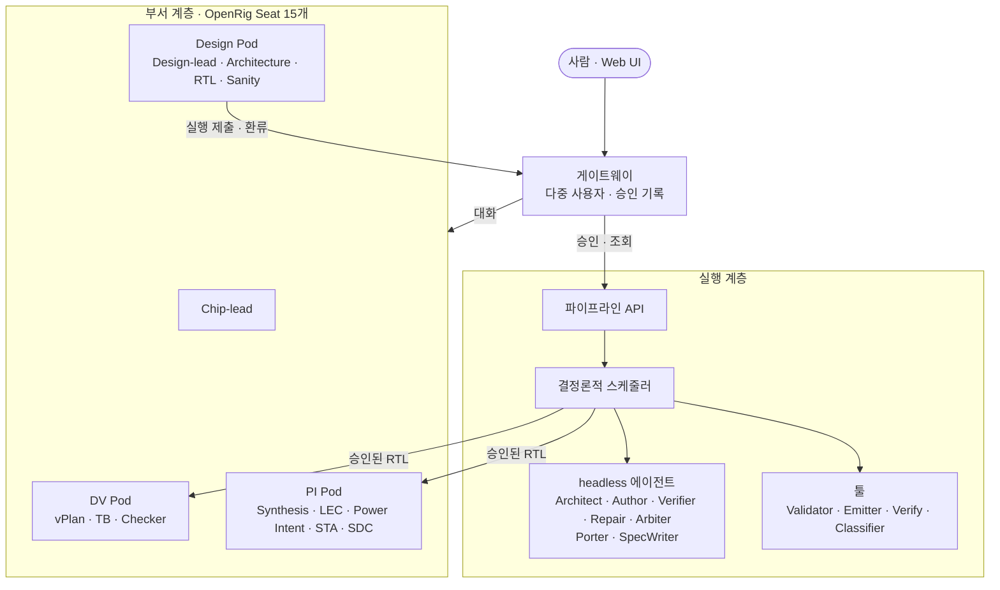
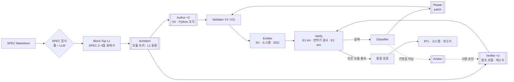
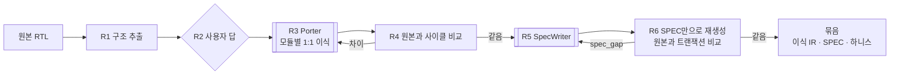

# Chip Design Department

SPEC에서 RTL Freeze까지를 맡는 IR 기반 RTL 설계 자동화 시스템입니다. 두 계층으로 이루어집니다.

- **실행 계층:** 결정론적 스케줄러와 headless coding agent로 SPEC에서 RTL을 생성하고 검증합니다.
- **부서 계층:** 영속적인 Seat(coding agent 장기 세션)가 계획, 운영, 독립 검증(DV, PI)을 맡고, 사람은 게이트웨이와 Web UI로 승인합니다.

검증된 원본 RTL이 있으면 이식 흐름으로 원본과 사이클 등가인 IR과 SPEC을 함께 만듭니다.

| 문서 | 내용 |
| --- | --- |
| [ARCHITECTURE.md](./ARCHITECTURE.md) | 전체 구조의 지도 (이 README의 아키텍처 절은 요약) |
| [IMPLEMENTATION.md](./IMPLEMENTATION.md) | 단계별 구현 계획과 결과 |
| [PROGRESS.md](./PROGRESS.md) | 진행 기록, 대기 항목 |
| [docs/LLM 기반 RTL 생성 파이프라인 설계.md](./docs/LLM%20기반%20RTL%20생성%20파이프라인%20설계.md) | SPEC 규격, 파이프라인, IR 스키마, Validator, 검증 |
| [docs/Chip Design Department 설계.md](./docs/Chip%20Design%20Department%20설계.md) | 부서 계층, Seat, 환류, 승인, Web UI |
| [docs/SPEC 작성 템플릿.md](./docs/SPEC%20작성%20템플릿.md) | 파이프라인 입력 SPEC의 10개 절 |
| [docs/RTL 코딩 규칙.md](./docs/RTL%20코딩%20규칙.md) | 생성 RTL이 지키는 규칙과 강제하는 검사 |
| [docs/용어집.md](./docs/용어집.md) | 문서와 코드에서 쓰는 말 |
| [gateway/README.md](./gateway/README.md) | 게이트웨이와 Web UI |

---

## 1. 아키텍처

### 1.1 핵심 원칙

| 원칙 | 내용 |
| --- | --- |
| IR이 유일한 소스 | RTL은 늘 IR에서 방출합니다. RTL을 IR로 되돌리는 역파싱은 없고, 모든 수정은 파이프라인 입력(SPEC, patch)으로 들어갑니다. |
| 구조는 툴, 동작은 LLM | 계층, 인터페이스, 상태 선언은 JSON이고 툴이 보장합니다. 동작은 타입이 붙은 슬롯 안의 조각(SV 또는 사이클 단위 Python)이라 오류가 조각 하나로 좁혀집니다. |
| 결정론적 제어 흐름 | 순서, 분기, 반복 상한, 게이트는 스케줄러가 정합니다. 에이전트끼리는 메시지를 주고받지 않고 산출물로만 통신합니다. |
| 생성과 검증의 격리 | Author와 Verifier는 서로의 산출물을 볼 수 없습니다. DV Pod는 파이프라인 테스트를 보지 않고 따로 검증합니다. 격리는 프롬프트가 아니라 작업 디렉터리, patch 적용 툴, Validator V11(동결 해시)이 강제합니다. |
| coding agent 기반 | LLM은 모두 coding agent 세션(기본 Claude Code)으로 씁니다. 모델 API를 직접 부르는 코드는 없습니다. |
| 사람 승인 세 곳 | SPEC 고정, 최종 승인, RTL Freeze입니다. 실행 중 게이트는 멈추지 않고 검토 항목으로 남깁니다. 기댓값(테스트) 변경은 따로 사람 승인을 받습니다. |
| 폐쇄망 | 전체를 폐쇄망과 로컬 모델로 돌리는 것을 전제로 합니다. 오픈소스 EDA는 사내 툴로 바꿀 자리입니다. |

### 1.2 시스템 구성



| 계층 | 코드 | 실행 |
| --- | --- | --- |
| 실행 계층 | `pipeline/` | `chipdept run`, `chipdept port`, `chipdept api serve` |
| 게이트웨이 + Web UI | `gateway/` | `chipdept gateway serve` |
| 부서 계층 | `department/` (Seat 명단, rig.yaml, Seat 지침, Seat 도구) | `chipdept dept up` |

### 1.3 RTL 생성 파이프라인 (SPEC → RTL)



이중 괄호가 LLM 에이전트이고 나머지는 결정론적 툴입니다.

| 단계 | 코드 | 하는 일 |
| --- | --- | --- |
| SPEC 변환 | `pipeline/spec/pdf.py`, `waveform.py`, `regmap.py` | PDF → Markdown, 타이밍 다이어그램 → WaveJSON, 레지스터 맵 파싱 |
| SPEC 검사 | `pipeline/spec/check.py`, `llm_check.py` | 형식, 요구사항 ID, 모호한 문장 검사. 결과는 검토 항목 |
| Block Top L1 | `pipeline/spec/l1.py` | SPEC 2~4절 표(클럭·리셋, 인터페이스, 파라미터)에서 L1을 결정론적으로 만듦 |
| Architect, Author, Verifier, Repair, Arbiter | `pipeline/agents/` | 과제 파일과 입력을 격리된 작업 디렉터리에 두고 headless로 실행 (`task.py`, `runner.py`) |
| Validator | `pipeline/validator/` | V1 스키마 ~ V11 동결. JSON Schema, 심볼 테이블, pyslang AST, reads/writes 그래프 |
| Emitter | `pipeline/emitter/` | IR → SV(`// @ir` 주석), 소스맵, SDC 골격. 표준 셀 스텁은 `emitter/stubs/` |
| Verify | `pipeline/verify/run.py` | E1 Verilator `-Wall` lint, E2 Verilator + cocotb sim |
| 번역기 검사 | `pipeline/verify/pyequiv.py`, `pipeline/ir/pysim.py` | `lang: py` 모듈의 설계 모델과 방출 RTL을 같은 무작위 자극으로 비교 |
| 하니스 | `pipeline/tb/` | L1에서 cocotb 하니스 생성, 프로토콜 체커, 스코어보드, 후보 간 차분 시뮬레이션 |
| Classifier | `pipeline/classifier/` | 실패 유형 분류와 대상 노드 (소스맵 사용) |
| 스케줄러 | `pipeline/scheduler/run.py` | 위 흐름 전체. 상태는 `state.json`에 저장하고 같은 명령으로 이어 감 |

### 1.4 이식 흐름 (원본 RTL → IR, SPEC)



결과 묶음(`package/`)은 golden 블록과 같은 형식이라 일반 파이프라인에 그대로 넣을 수 있습니다. 코드는 `pipeline/importer/`(R1, R2, R4, R6)와 `pipeline/scheduler/port.py`입니다. 세부 규칙은 [ARCHITECTURE.md 4.5](./ARCHITECTURE.md)를 봅니다.

### 1.5 IR

IR은 모듈당 JSON 파일 하나입니다 (스키마: `schema/`).

| 계층 | 필드 | 내용 |
| --- | --- | --- |
| L0 | `instances`, `connections` | 인스턴스와 연결 |
| L1 | `params`, `domains`, `ports` | 파라미터, 클럭·리셋 도메인, 포트와 프로토콜 번들 |
| L2 | `types`, `signals` | 타입, 신호 |
| L3 | `blocks`, `functions`, `assertions` | `comb`, `seq`, `fsm`, `cdc_sync`, `cdc_fifo`, `memory`, `tristate`, 함수, SVA |

모든 모듈의 L1과 인스턴스 목록, `top`/`block_top`의 연결은 Architect 뒤에 동결되고, Author와 Repair는 L2와 L3만 씁니다.

## 2. 저장소 구조

| 경로 | 내용 |
| --- | --- |
| `pipeline/` | 실행 계층 (위 표). `pipeline/cli.py`가 `chipdept` 실행기 |
| `pipeline/agents/prompts/` | 에이전트 과제 안내 (IR, 하니스 작성 안내 등) |
| `gateway/` | 게이트웨이 서버와 Web UI (`gateway/ui/`, React + Vite) |
| `department/` | Seat 명단, `rig.yaml`, Seat 지침(`guidance/`), Seat 도구(`bin/deptctl`, `bin/eda`), sandbox 프로필 |
| `config/` | 역할 설정(`roles*.json`), 외부 리포트 양식(`report_formats/`) |
| `schema/` | IR JSON Schema |
| `blocks/` | 파이프라인에 넣는 Block Top SPEC (`axis_crc_append`) |
| `examples/` | 예시 SPEC |
| `tests/` | 시험. `tests/golden/`은 원본 RTL과 손으로 옮긴 IR이 있는 golden 블록, `tests/sim/`은 시뮬레이션 시험 |
| `experiments/` | 단계별 실험과 에이전트 설정(`experiments/p0/local/agents.*.json`) |
| `docs/` | 설계 문서 |

## 3. 설치

### 3.1 필요한 것

| 구성 | 판 | 쓰는 곳 |
| --- | --- | --- |
| Python | 3.11 이상 | 전체 |
| Verilator | 5.052에서 확인 | E1 lint, E2 sim, 이식 R4/R6 원본 시뮬레이션 |
| Yosys | 0.70에서 확인 | `chipdept eda` (synth, lec, sta, comb) |
| coding agent CLI | Claude Code(기본). agy, Pi, Codex도 설정으로 | 에이전트 실행 |
| Node.js | | Web UI 빌드, OpenRig (부서 계층만) |

### 3.2 파이썬 환경

```bash
uv venv --python 3.11 .venv                 # 또는 python3.11 -m venv .venv
uv pip install --python .venv/bin/python -e ".[dev]"
.venv/bin/chipdept                          # 명령 목록
```

`chipdept`는 `gateway/`와 `department/`를 저장소에서 찾으므로 editable 설치(`-e`)로 씁니다. 설치하지 않았으면 저장소 루트에서 `python3 -m pipeline`으로 같은 명령을 부릅니다.

선택 의존성: `spec`(PDF, 엑셀 SPEC 입력), `golden`(golden 블록의 원본 테스트벤치), `dev`(둘 다 + pytest).

### 3.3 에이전트 설정

역할 설정(`config/roles.json`)이 역할마다 에이전트, 후보 수, 상한을 정하고, 에이전트 설정 파일을 가리킵니다.

```json
{
  "agents": "experiments/p0/local/agents.claude.json",
  "roles": {
    "architect": {"agent": "cc-verifier", "count": 1},
    "author":    {"agent": "cc-author",   "count": 2, "langs": ["sv", "py"]},
    "verifier":  {"agent": "cc-verifier", "count": 2},
    "repair":    {"agent": "cc-author",   "count": 1},
    "arbiter":   {"agent": "cc-verifier", "count": 1},
    "porter":    {"agent": "cc-author",   "count": 1},
    "spec_writer": {"agent": "cc-verifier", "count": 1}
  },
  "limits": {"repair_per_candidate": 3, "budget_agent_runs": 60, "porter_fix": 3, "spec_revise": 3}
}
```

- 에이전트 설정 파일은 에이전트마다 실행 명령(`{prompt}`, `{model}` 자리), 모델, 계열(`family`), 시간 제한을 둡니다. 예시는 `experiments/p0/agents.example.json`(로컬 모델 엔드포인트 포함)과 `experiments/p0/local/agents.*.json`입니다.
- Author와 Verifier가 같은 계열이면 스케줄러가 `MODEL_FAMILY` 경고를 검토 항목에 남깁니다.
- 이식 흐름용 설정 예: `config/roles.port-haiku-medium.json`.
- 에이전트 작업 디렉터리는 저장소 밖(`CHIPDEPT_RUNS`, 기본 `~/.cache/chip-design-department/runs`)에 만들고 서로 격리합니다.

## 4. chipdept 사용법

```text
chipdept                         명령 목록
chipdept <그룹>                  그룹의 명령 목록
chipdept <그룹> <명령> [인자...]  실행
chipdept <명령> --help           명령별 인자
```

`chipdept`는 기존 모듈의 CLI를 한곳에 묶은 실행기입니다. 인자는 그대로 해당 모듈에 넘기고, 종료 코드도 그대로 돌려줍니다.

| 명령 | 모듈 | 하는 일 |
| --- | --- | --- |
| `spec pdf` | `pipeline.spec.pdf` | PDF SPEC → Markdown |
| `spec waveform` | `pipeline.spec.waveform` | 타이밍 다이어그램 → WaveJSON (비전 coding agent) |
| `spec regmap` | `pipeline.spec.regmap` | 레지스터 맵(xlsx, CSV) 파싱과 검사 |
| `spec check` | `pipeline.spec.check` | SPEC 검사 게이트 |
| `spec llm-check` | `pipeline.spec.llm_check` | SPEC LLM 검사 |
| `spec l1` | `pipeline.spec.l1` | SPEC 2~4절 표 → Block Top L1 |
| `run` | `pipeline.scheduler.run` | 파이프라인 실행 (SPEC → RTL) |
| `approve` | `pipeline.scheduler.approve` | 실행이 기다리는 사람 결정 보기와 결정 |
| `port` | `pipeline.scheduler.port` | 이식 흐름: `start`, `answer`, `resume`, `status` |
| `ir r1` | `pipeline.importer.r1` | 원본 RTL → 모듈별 L1·L0 초안 |
| `ir patch` | `pipeline.patch.apply` | IR에 patch 적용 |
| `ir emit` | `pipeline.emitter.sv` | IR → SystemVerilog, 소스맵 |
| `ir pyequiv` | `pipeline.verify.pyequiv` | 번역기 검사 (설계 모델 대 RTL) |
| `tb gen` | `pipeline.tb.gen` | L1 → cocotb 하니스 |
| `tb report` | `pipeline.tb.report` | sim 불일치 리포트, FSM 전이 커버리지 |
| `verify` | `pipeline.verify.run` | `lint`(E1), `sim`(E2) |
| `report` | `pipeline.feedback.reports` | 외부 검사 리포트 파서 |
| `tool` | `pipeline/agents/pl.py` | 에이전트 도구: `validate`, `emit`, `fanin`, `trace`, `spec`, `harness`, `model`, `pysim`, `porteq`, `refsim`, `spec_gate` |
| `api` | `pipeline.api` | 파이프라인 API 서버와 CLI |
| `gateway` | `gateway` | 게이트웨이: `init`, `user`, `seats`, `serve` |
| `dept` | `department/dept.py` | 부서 계층: `up`, `down`, `status`, `reset`, `run`, `rig` |
| `eda` | `department/bin/eda` | 오픈소스 EDA 검사: `lint`, `synth`, `lec`, `sta`, `sdc`, `comb` |

`chipdept tool`은 에이전트가 작업 디렉터리에서 쓰는 도구와 같습니다. 사람이 부를 때는 도구 사용 기록(`.tools.log`)을 남기지 않습니다.

## 5. 작업 흐름

### 5.1 SPEC 검사

SPEC은 [SPEC 작성 템플릿](./docs/SPEC%20작성%20템플릿.md)의 10개 절을 따릅니다.

```bash
chipdept spec pdf vendor_spec.pdf --pages 37-80 -o build/spec      # PDF가 원본이면 먼저 Markdown으로
chipdept spec check blocks/axis_crc_append/block_spec.md -o build/spec_check
chipdept spec l1 blocks/axis_crc_append/block_spec.md -o build/axis_crc_append.l1.json
```

`spec check`는 게이트 결과와 함께 `review.md`(오류, 경고, 검토 항목)와 SPEC에서 만든 L1을 냅니다. 오류가 있으면 종료 코드가 0이 아닙니다.

### 5.2 파이프라인 실행 (SPEC → RTL)

```bash
chipdept run blocks/axis_crc_append/block_spec.md --run-dir build/runs/crc --roles config/roles.json
```

- 멈췄다가 같은 명령으로 다시 실행하면 끝난 단계와 끝난 에이전트 작업을 건너뛰고 이어 갑니다.
- 실행 디렉터리: `state.json`(상태), `scheduler.log`, `ir/`(최종 IR), `rtl/`(SV, 소스맵, SDC), `harness/`, `verify/`, `diffsim/`, `tasks/`(에이전트 작업별 과제와 출력), `report.json`(최종 보고서).
- 기댓값 변경(Arbiter가 테스트가 틀렸다고 판정)이나 Repair 충돌이 생기면 해당 모듈만 멈추고 사람 결정을 기다립니다.

```bash
chipdept approve build/runs/crc list
chipdept approve build/runs/crc show E1
chipdept approve build/runs/crc approve E1 --by kim --note "SPEC CRC-E01대로 리셋 다음 사이클부터"
chipdept approve build/runs/crc resolve E2 --repair axis_crc_core --by lead --note "..."   # Repair 충돌 (Design-lead)
chipdept run blocks/axis_crc_append/block_spec.md --run-dir build/runs/crc --roles config/roles.json   # 결정 반영
```

결정은 `<run_dir>/decisions.json`에 남고 되돌리지 않습니다.

### 5.3 이식 흐름 (원본 RTL → IR, SPEC)

```bash
chipdept port start tests/golden/axis_adapter/upstream/rtl/axis_adapter.v --top axis_adapter \
    -G S_DATA_WIDTH=8 -G M_DATA_WIDTH=32 -G M_KEEP_ENABLE=1 --run-dir build/port/adapter
chipdept port status --run-dir build/port/adapter          # R1 뒤 R2에서 멈추고, 물을 항목(questions)을 보여 줌
chipdept port answer --run-dir build/port/adapter freq.sys=100 \
    proto.axis_adapter.s_axis=valid_ready proto.axis_adapter.m_axis=valid_ready review.1=ok review.2=ok
chipdept port resume --run-dir build/port/adapter --roles config/roles.port-haiku-medium.json
```

- 항목 ID는 `status`의 `questions`에 나옵니다: 주파수(`freq.<도메인>`, MHz), 도메인 관계(`rel.<a>.<b>`), 번들 프로토콜(`proto.<모듈>.<번들>`), R1 검토 항목(`review.<번호>`, `ok` 또는 `stop`). 답을 JSON 파일로 줄 때는 `--file answers.json`.
- `-G`로 고정한 파라미터는 elaborate에 쓰이고, 고정 값은 SPEC과 `golden.json`에 남습니다.

- `resume --until r4|r5|r6`으로 중간 단계까지만 돌릴 수 있습니다.
- R6 재생성 실행이 사람 결정으로 멈추면 `waiting_regen` 상태가 됩니다. 재생성 실행 디렉터리(`<run_dir>/r6/regen_<회차>`)에 `chipdept approve`로 결정하고 `port resume`으로 이어 갑니다.
- 결과 묶음: `<run_dir>/package/` (`ir/`, `spec.md`, `harness/`, `golden.json`).

### 5.4 부서 계층과 게이트웨이

```bash
cd gateway/ui && npm ci && npm run build && cd ../..   # Web UI 빌드
chipdept gateway init --admin admin                   # DB, 파이프라인 API 토큰, 관리자 (비밀번호는 표준 입력)
chipdept gateway user add park --roles approver
chipdept dept up --mode agent                         # OpenRig rig: Seat 15개, 파이프라인 API, 게이트웨이
chipdept dept status
chipdept dept down
```

- 게이트웨이만 따로 띄울 때는 `chipdept api serve --port 8740`과 `chipdept gateway serve --port 8750`을 씁니다.
- Web UI는 `http://127.0.0.1:8750`입니다. 실행 제출, 승인 다섯 가지, SPEC 작업대, 환류 양식을 제공합니다.
- 역할과 승인 규칙은 [gateway/README.md](./gateway/README.md)를 봅니다.
- Seat는 `deptctl`(게이트웨이 클라이언트, Seat API 키)과 `eda`를 씁니다. `deptctl`은 Seat 환경 변수가 있어야 하므로 `chipdept`에 넣지 않았습니다.

### 5.5 개별 도구

```bash
chipdept tool validate tests/golden/axis_adapter/ir/axis_adapter.ir.json     # Validator (JSON 결과)
chipdept ir emit tests/golden/axis_adapter/ir/axis_adapter.ir.json -o build/emit
chipdept verify lint --top axis_adapter build/emit/axis_adapter.sv
chipdept tb gen build/axis_crc_append.l1.json -o build/harness --trace-out build/trace
chipdept eda synth build/emit --top axis_adapter
```

## 6. 환경 변수

| 변수 | 기본값 | 내용 |
| --- | --- | --- |
| `CHIPDEPT_RUNS` | `~/.cache/chip-design-department/runs` | 에이전트 작업 디렉터리 |
| `CHIPDEPT_STORE` | `~/.cache/chip-design-department/dept/store` | 파이프라인 API 저장소 (실행, SPEC) |
| `CHIPDEPT_API` | `http://127.0.0.1:8740` | 게이트웨이가 부르는 파이프라인 API |
| `CHIPDEPT_GATEWAY_HOME` | `~/.cache/chip-design-department/gateway` | 게이트웨이 DB, API 토큰 |
| `OPENRIG_URL` | `http://127.0.0.1:7533` | OpenRig 데몬 |

부서 계층의 나머지 변수(`CHIPDEPT_DEPT_HOME`, `CHIPDEPT_OPENRIG`, `CHIPDEPT_API_PORT` 등)는 `department/dept.py`와 `department/bin/pipeline-server`에 있습니다.

## 7. 시험

```bash
.venv/bin/python -m pytest -q --ignore=tests/sim     # 빠른 시험 (수십 초)
.venv/bin/python -m pytest -q tests/sim              # 시뮬레이션 시험 (Verilator, 약 15분)
CHIPDEPT_RIG_TEST=1 .venv/bin/python -m pytest tests/test_department.py -s   # OpenRig를 띄우는 부서 계층 시험
```

파이프라인 시험은 가짜 에이전트(`tests/fake_agent.py`, `tests/fake_port_agent.py`)로 돌므로 coding agent가 없어도 됩니다. golden 블록의 원본 테스트벤치는 `tests/golden/run_golden.py`로 돌립니다 ([tests/golden/README.md](./tests/golden/README.md)).
